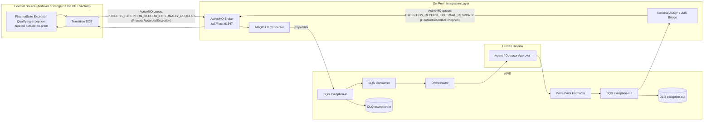

Diagram Chart:

## Notas / Hallazgos posteriores (actualizado tras revisión de mi manager y respuestas de Justin)

Estos puntos actualizan el diagrama original, basado en `SummaryOfChapter28.md` y en el diagrama de colas de ActiveMQ compartido por el equipo de PharmaSuite:

1. **Prerrequisito de configuración pendiente**: `ActivateExternalExceptionHandling` **no está habilitado actualmente en ninguno de los 3 sitios de Pfizer** (Andover, Grange Castle DP, Sanford). Esto debe activarse antes de que el flujo `ProcessRecordedException` pueda dispararse. Acción con Justin.
2. **Nombres reales de las colas ActiveMQ** (confirmados vía diagrama, no estaban completos en el manual técnico):
   - Entrante (PharmaSuite → agente externo): `PROCESS_EXCEPTION_RECORD_EXTERNALLY_REQUEST`
   - Saliente (agente externo → PharmaSuite): `EXCEPTION_RECORD_EXTERNAL_RESPONSE`
   - El nombre exacto de cola de salida no estaba claramente documentado en el TG Chapter 28; se resolvió con el diagrama, pero falta confirmar detalles de conexión (host/puerto/credenciales) por sitio — pendiente con Amey.
3. **`ExceptionReference`** corresponde a la ruta/referencia de la excepción (Unit Procedure/Operation/Phase), mientras que **`PSUniqueExceptionID`** es el identificador único de la excepción en PharmaSuite (confirmado por Justin).
4. **Umbral de riesgo (`MinimalRiskClassForExternalExceptionHandling`)**: por defecto solo aplica a excepciones de riesgo **High**. Se necesita confirmar con Justin/config team si Pfizer ajustará este umbral para cubrir la población completa Tier A/B, no solo High.
5. **`ActivateExceptionClassification`**: Pfizer probablemente no utiliza clasificación de excepciones (a confirmar).
6. **`getOtherInformation()`**: confirmado que puede usarse para enriquecer el mensaje con datos de proceso adicionales (ej. valores medidos, límites violados) si se requiere en el futuro, ya que el esquema estándar no los incluye como campos separados.