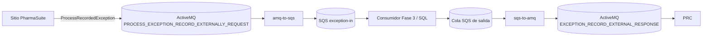

# Puente ActiveMQ ⇄ AWS SQS

*English version: [README.md](README.md)*

Dos contenedores independientes que mueven los mensajes de excepciones de PharmaSuite entre ActiveMQ (OpenWire nativo) y AWS SQS:

| Contenedor | Dirección | Origen por defecto | Destino por defecto |
|---|---|---|---|
| `amq-to-sqs` | Ingesta (Fase 2 de `PlanActiveMQ_a_SQL.md`) | ActiveMQ `PROCESS_EXCEPTION_RECORD_EXTERNALLY_REQUEST` | SQS `exception-in` |
| `sqs-to-amq` | Respuesta hacia PRC (Fase 5) | Cola SQS de salida (nombre por definir) | ActiveMQ `EXCEPTION_RECORD_EXTERNAL_RESPONSE` |



`amq-to-sqs` se ejecuta una vez para todos los sitios configurados. Lee el broker ActiveMQ, la cola de entrada y el destino SQS de cada sitio desde `ingestion.yaml`; cada mensaje se envía a la cola SQS de esa misma entrada y lleva el atributo `site`. Selecciona el entorno con `--env DEV`, `--env QA` o `--env PROD`. El módulo `sqs-to-amq` permanece como puente independiente de salida.

---

## Estructura del proyecto

```
activemq-sqs-bridge/
├── pom.xml                      # Maven padre (Java 17, activemq-client 5.15.0, AWS SDK v2)
├── bridge-common/               # Librería compartida
├── amq-to-sqs/                  # Ingesta multi-sitio ActiveMQ -> SQS
│   └── Dockerfile
├── sqs-to-amq/                  # Contenedor 2: SQS -> ActiveMQ
│   └── Dockerfile
├── ingestion.yaml               # Mapeo de sitios por entorno
├── config/
│   └── sqs-to-amq.env.example
├── local/localstack-init/
│   └── create-queues.sh         # Crea las colas SQS y sus DLQ en LocalStack
└── docker-compose.yml           # Stack local de pruebas
```

`activemq-client` está fijado en **5.15.0** porque es la `ProviderVersion` que el broker de destino informó en su handshake OpenWire.

---

## Módulos

### `bridge-common`: librería compartida

Todos los servicios usan este módulo, así que la conexión, la configuración y los reintentos funcionan igual en todos.

| Clase | Responsabilidad |
|---|---|
| `EnvConfig` | Lee la configuración comprobando su tipo: `required`, `optional`, `intValue`, `longValue`, `boolValue`, `durationValue`. Los valores salen de variables de entorno y, opcionalmente, de un fichero `CLAVE=VALOR` indicado con `--config <fichero>` o `BRIDGE_CONFIG_FILE`. Las variables de entorno reales tienen prioridad sobre el fichero. Las duraciones aceptan `500ms`, `30s`, `5m`, `10m`, `1h`, `1h30m`, `1d` o ISO-8601 (`PT10M`). Un número sin unidad distinto de `0` se rechaza porque su unidad sería ambigua. Si falta un valor o no es válido, lanza `ConfigException` y la aplicación termina con código 2 antes de conectarse a nada. `secret(KEY)` también acepta `KEY_FILE`, para montar las contraseñas como secretos de Docker/Kubernetes en vez de pasarlas como variables. |
| `ActiveMqPoller` | Bucle compartido de consumo ActiveMQ (sesión `INDIVIDUAL_ACKNOWLEDGE`, reconexión con espera). Con `ACTIVEMQ_POLL_INTERVAL=0` consume de forma continua; con una duración positiva vacía la cola, se desconecta y espera. Cada sitio configurado tiene su propio poller. |
| `MessageMetadata` | Metadatos JMS que acompañan al mensaje (sitio, cola, ID JMS, timestamp, content type) y se convierten en atributos SQS. |
| `XmlInspector` | Inspecciona los XML y, opcionalmente, valida su esquema XSD. |
| `ActiveMqSettings` | Construye el `ActiveMQConnectionFactory` a partir de las variables `ACTIVEMQ_*`. Envuelve automáticamente la URL en `failover:(...)`, así el cliente se reconecta con espera exponencial, y el `timeout` del failover hace que un envío bloqueado falle en vez de quedarse colgado. Con URLs `ssl://` usa `ActiveMQSslConnectionFactory`, con truststore y keystore opcionales (para TLS mutuo). Fija prefetch = 1, así nunca hay más de un mensaje sin confirmar en memoria, y una política de reentrega ilimitada, para que el cliente nunca mande un mensaje a la DLQ del broker. Desactiva los advisory topics, que suelen necesitar permisos extra en el broker. `describe()` devuelve un resumen apto para logs, sin contraseñas. |
| `SqsSettings` | Construye el `SqsClient` del AWS SDK v2 a partir de `AWS_REGION`, `SQS_QUEUE_URL` y, opcionalmente, `SQS_ENDPOINT_OVERRIDE` (para LocalStack o un endpoint de VPC). Las credenciales salen de la **cadena estándar de credenciales de AWS** (variables de entorno, `AWS_PROFILE`, web identity, rol del contenedor o de la instancia), así que el código nunca maneja secretos. Trata la cola como FIFO cuando la URL termina en `.fifo`. También respeta `AWS_ACCESS_KEY_ID`/`AWS_SECRET_ACCESS_KEY`/`AWS_SESSION_TOKEN` o `AWS_PROFILE` puestos en un fichero `--config`, porque el SDK por sí solo solo ve las variables de entorno reales. |
| `Backoff` | Espera exponencial con jitter (`RETRY_INITIAL_DELAY_MS`, `RETRY_MAX_DELAY_MS`). Se usa en todos los bucles de reconexión y reintento. |
| `BridgeRunner` | Ejecuta el bucle del puente en el hilo principal y registra un shutdown hook. Al recibir SIGTERM/SIGINT (`docker stop`) le indica al bucle que pare y espera hasta `SHUTDOWN_GRACE_MS` a que termine el trabajo en curso. |
| `simplelogger.properties` | Escribe los logs en stdout con fecha y nombre del hilo. Baja a `warn` los mensajes del AWS SDK y del cliente HTTP para reducir ruido. |

### `amq-to-sqs`: contenedor de ingesta

Inicia un consumidor independiente por cada sitio del entorno seleccionado. Cada consumidor envía a la cola SQS de ese sitio, añade el atributo `site` y confirma el mensaje de ActiveMQ solo cuando SQS lo acepta. La caída de un broker no detiene los consumidores de otros sitios.

| Clase | Responsabilidad |
|---|---|
| `AmqToSqsApp` | Punto de entrada. Lee `INGESTION_CONFIG` y el argumento obligatorio `--env`, valida los sitios, obtiene los secretos opcionales y arranca los trabajadores. |
| `MultiSiteBridge` | Ejecuta el consumidor de cada sitio en un hilo independiente. |
| `AmqToSqsBridge` | Lee `TextMessage` y `BytesMessage` (como UTF-8), pasa cada mensaje al publicador Python y lo confirma tras recibir éxito. Los envíos fallidos se reintentan con espera y quedan sin confirmar; un rechazo permanente puede bloquear la cola de ese sitio. Los logs identifican solo sitio e ID, nunca el contenido. |
| `PythonSqsPublisher` | Mantiene un proceso local y le envía la URL SQS del sitio, la región, el cuerpo y los atributos mediante líneas JSON. |
| `sqs_publisher.py` | Usa `boto3.client("sqs", region_name=...)` y `send_message(QueueUrl=...)`. La URL procede de `sqs.queue_url` en la entrada YAML del mismo sitio. |
| `XmlInspector` | Analiza el contenido con un parser DOM protegido contra XXE: DOCTYPE prohibido, procesamiento seguro activado y acceso externo bloqueado. Extrae `PSUniqueExceptionID`. Si `XSD_PATH` apunta a `RAExternalExceptionHandling.xsd`, también valida el contenido. La inspección **nunca bloquea el reenvío**: un contenido inválido o que no es XML se envía igualmente con `SchemaValid=false`, y el consumidor posterior decide qué hacer con él. |

**Atributos que se añaden al mensaje SQS:**

| Atributo | Valor |
|---|---|
| `site` | Nombre exacto del sitio en la entrada YAML seleccionada |
| `SourceSite` | Nombre del sitio (se usa para el etiquetado de S2) |
| `SourceQueue` | Nombre de la cola de ActiveMQ |
| `JmsMessageId` | ID original del mensaje JMS |
| `JmsTimestamp` | Timestamp JMS (Number) |
| `ContentType` | Propiedad JMS `ContentType`, o `text/xml` si no existe |
| `PSUniqueExceptionID` | Extraído del XML, si está presente |
| `SchemaValid` | `true`/`false`; solo se incluye si `XSD_PATH` está configurado |

### `sqs-to-amq`: contenedor de respuesta

Lee una cola SQS con long polling y publica cada mensaje en la cola de salida de ActiveMQ.

| Clase | Responsabilidad |
|---|---|
| `SqsToAmqApp` | Punto de entrada. Prepara la petición `ReceiveMessageRequest` (tamaño de lote, espera de long polling, visibility timeout opcional, todos los atributos) y el publicador, y arranca el puente. |
| `SqsToAmqBridge` | Bucle principal. Recibe un lote, publica cada mensaje en ActiveMQ y **solo lo borra de SQS cuando el broker lo ha aceptado**. Si la publicación falla, reinicia la conexión con ActiveMQ, espera y deja de procesar el lote actual. Los mensajes restantes vuelven a estar visibles cuando vence el visibility timeout y, tras el `maxReceiveCount` de la cola, pasan a la DLQ de SQS (la redrive policy se configura en AWS). Si el borrado falla después de una publicación correcta, escribe un aviso en el log, porque el mensaje se volverá a entregar como duplicado. Los atributos SQS de tipo String/Number se convierten en propiedades JMS de tipo string; sus nombres se ajustan para que sean identificadores Java válidos y nunca empiecen por el prefijo reservado `JMS`. Añade `SqsMessageId`, y `ContentType` vale `text/xml` por defecto. |
| `ActiveMqPublisher` | Productor que se conecta solo cuando hace falta y se reconecta si se pierde la conexión. Los envíos persistentes (la opción por defecto) son síncronos: `send()` solo devuelve el control cuando el broker ha aceptado el mensaje. Admite un tiempo de vida (TTL) opcional para el mensaje. |

### Garantías de entrega

Los dos sentidos son **at-least-once**: un mensaje no debería perderse, pero puede llegar dos veces. Por eso sigue haciendo falta la comprobación de duplicados de la Fase 3.2 en el consumidor. Las colas FIFO reducen los duplicados en el lado de SQS, pero solo dentro de la ventana de deduplicación de 5 minutos.

### Limitaciones conocidas

- Durante una caída del broker, una conexión o un envío pueden quedarse bloqueados hasta que vence el `timeout` del failover (30 s por defecto), antes de que el puente reaccione o se apague.
- `sqs-to-amq` no valida el contenido, porque el esquema de respuesta de PRC todavía no está definido (Fase 5.2).

---

## Referencia de configuración

`amq-to-sqs` lee los sitios desde `ingestion.yaml` (o desde la ruta indicada en `INGESTION_CONFIG`) y requiere `--env DEV|QA|PROD`. Las contraseñas del broker se guardan en AWS Secrets Manager; `credentials_secret` contiene el nombre del secreto. El valor del secreto debe ser un objeto JSON con `username` y `password`. El ajuste de ejecución y las credenciales de AWS se proporcionan mediante variables de entorno. `sqs-to-amq` conserva su fichero de configuración basado en variables.

### Variables de entorno de `sqs-to-amq`

| Variable | Obligatoria | Por defecto | Descripción |
|---|---|---|---|
| `ACTIVEMQ_URL` | sí | — | p. ej. `tcp://aznaampstalos1i:61646` o `ssl://host:61647` |
| `ACTIVEMQ_QUEUE` | no | cola de salida | Cola en la que se publica |
| `ACTIVEMQ_USER` | no | anónimo | Usuario del broker |
| `ACTIVEMQ_PASSWORD` / `ACTIVEMQ_PASSWORD_FILE` | no | — | Contraseña del broker |
| `ACTIVEMQ_USE_FAILOVER` | no | `true` | Envolver la URL en `failover:(...)` |
| `ACTIVEMQ_FAILOVER_OPTIONS` | no | `initialReconnectDelay=1000&maxReconnectDelay=30000&useExponentialBackOff=true&timeout=30000` | Opciones del transporte failover |
| `ACTIVEMQ_SSL_TRUSTSTORE` / `_PASSWORD` | para `ssl://` | — | Ruta y contraseña del truststore |
| `ACTIVEMQ_SSL_KEYSTORE` / `_PASSWORD` | solo TLS mutuo | — | Keystore del cliente |
| `ACTIVEMQ_MAX_REDELIVERIES` | no | `-1` | Política de reentrega del cliente (`-1` = ilimitada) |
| `AWS_REGION` | sí | — | Región de AWS |
| `SQS_QUEUE_URL` | sí | — | Cola de origen |
| `SQS_ENDPOINT_OVERRIDE` | no | — | LocalStack o endpoint de VPC |
| Credenciales AWS | sí | — | Cadena estándar: `AWS_ACCESS_KEY_ID`/`AWS_SECRET_ACCESS_KEY`, `AWS_PROFILE`, rol, … |
| `RETRY_INITIAL_DELAY_MS` / `RETRY_MAX_DELAY_MS` | no | `1000` / `60000` | Límites de la espera entre reintentos |
| `SHUTDOWN_GRACE_MS` | no | `15000` / `30000` | Tiempo que el apagado espera al trabajo en curso |
| `JAVA_OPTS` | no | `-XX:MaxRAMPercentage=75` | Opciones de la JVM. La JVM ignora `HTTPS_PROXY`; para usar un proxy, pasa aquí `-Dhttps.proxyHost=... -Dhttps.proxyPort=...`. |

### Variables de entorno de `amq-to-sqs`

| Variable | Obligatoria | Por defecto | Descripción |
|---|---|---|---|
| `INGESTION_CONFIG` | no | `./ingestion.yaml` | Ruta al fichero YAML |
| `--env` | sí | — | Entorno definido en YAML (`DEV`, `QA` o `PROD`) |
| `AWS_REGION` en YAML | sí | — | Región de AWS para SQS y Secrets Manager |
| `activemq.url`, `activemq.queue` | sí por sitio | — | Broker y cola de entrada |
| `sqs.queue_url` | sí por sitio | — | Cola de destino para los mensajes de ese broker |
| `activemq.credentials_secret` | no | `null` | Nombre del secreto de Secrets Manager con `username` y `password` en JSON |
| `SQS_ENDPOINT_OVERRIDE` | no | — | Endpoint de LocalStack o VPC |
| `XSD_PATH` | no | — | Ruta a `RAExternalExceptionHandling.xsd` |
| `SQS_MAX_MESSAGE_BYTES` | no | `262144` | Tamaño máximo del cuerpo SQS; los mensajes rechazados quedan sin confirmar |
| `ACTIVEMQ_RECEIVE_TIMEOUT_MS` | no | `1000` | Intervalo de espera de cada lectura (también limita lo que tarda el apagado) |
| `ACTIVEMQ_POLL_INTERVAL` | no | `0` | `0` = consumo continuo. Una duración (p. ej. `5m`, `10m`) = vaciar la cola, desconectarse y esperar ese tiempo |

### Solo `sqs-to-amq`

| Variable | Obligatoria | Por defecto | Descripción |
|---|---|---|---|
| `SQS_MAX_MESSAGES` | no | `10` | Mensajes por lectura (1–10) |
| `SQS_WAIT_TIME_SECONDS` | no | `20` | Tiempo de espera del long polling |
| `SQS_VISIBILITY_TIMEOUT_SECONDS` | no | el de la cola | Sobrescribe el visibility timeout |
| `ACTIVEMQ_PERSISTENT` | no | `true` | Entrega persistente (síncrona) |
| `ACTIVEMQ_MESSAGE_TTL_MS` | no | `0` | Tiempo de vida JMS (`0` = no caduca) |

### Permisos IAM mínimos

- `amq-to-sqs`: `sqs:SendMessage` sobre cada cola configurada.
- Si se configura `credentials_secret`: `secretsmanager:GetSecretValue` sobre el secreto del broker.
- `sqs-to-amq`: `sqs:ReceiveMessage` y `sqs:DeleteMessage` sobre la cola de salida.
- Si las colas usan SSE-KMS: `kms:GenerateDataKey` (quien envía) y `kms:Decrypt` (quien recibe) sobre esa clave.

---

## Compilar y ejecutar

```bash
# Compilar los JARs (Java 17 + Maven)
mvn -B package

# Construir las imágenes (el contexto de build es esta carpeta)
docker build -f amq-to-sqs/Dockerfile -t amq-to-sqs:1.0.0 .
docker build -f sqs-to-amq/Dockerfile -t sqs-to-amq:1.0.0 .

# Ejecutar un proceso para todos los sitios del entorno seleccionado
docker run -d --name amq-to-sqs \
  -e INGESTION_CONFIG=/etc/bridge/ingestion.yaml \
  -v "$PWD/ingestion.yaml:/etc/bridge/ingestion.yaml:ro" \
  amq-to-sqs:1.0.0 --env DEV
```

El contenedor incluye Java 17, Python 3 y boto3, y se ejecuta con un usuario sin privilegios (UID 10001). Para ejecutarlo fuera de Docker, instala `amq-to-sqs/requirements.txt` y define `PYTHON_PUBLISHER_SCRIPT` si no corresponde la ruta predeterminada del código fuente.

---

## Pruebas

> **Aviso:** `amq-to-sqs` **saca** los mensajes de la cola de entrada. En un broker compartido (el entorno de validación de Justin o la instancia de Rockwell), otras personas dejarán de ver esos mensajes. Coordínalo con ellos antes de apuntarlo ahí.

### 1. Levantar el stack local

```bash
cd activemq-sqs-bridge
docker compose up --build -d
docker compose logs -f amq-to-sqs
# debe aparecer un sitio configurado iniciando el consumo
```

El stack levanta ActiveMQ 5.15.9 (OpenWire en `61616`, consola web en `8161`, admin/admin), LocalStack SQS en `4566` con las colas `exception-in`, `exception-out` y sus DLQ, y los dos puentes. `amq-to-sqs` usa `config/local-ingestion.yaml` con el sitio local `DEV`.

### 2. Publicar un mensaje en ActiveMQ

Elige una de estas opciones:

- **Consola web:** entra en http://localhost:8161/admin, abre **Send**, pon como destino `PROCESS_EXCEPTION_RECORD_EXTERNALLY_REQUEST`, pega el contenido de `ProcessRecordedException.xml` y pulsa **Send**. En la instancia de Rockwell la página es `http://aznaampstalos1d.ra-int.com:8162/admin/send.jsp`.
- **API REST de ActiveMQ:**
  ```bash
  curl -u admin:admin --data-urlencode "body@ProcessRecordedException.xml" \
    "http://localhost:8161/api/message/PROCESS_EXCEPTION_RECORD_EXTERNALLY_REQUEST?type=queue"
  ```
- **Prueba real de punta a punta:** crea una excepción en PharmaSuite (`PlantOperations` en la instancia de Rockwell). `ActivateExternalExceptionHandling` tiene que estar activado, y el Risk Class de la excepción tiene que ser igual o superior a `MinimalRiskClassForExternalExceptionHandling`.

### 3. Comprobar que funcionó

- En los logs: `Forwarded message for site=LOCAL jmsId=... to SQS id=...`.
- En la consola de ActiveMQ: la cola muestra *Pending* = 0 y el contador *Dequeued* sube en 1.
- En SQS:
  ```bash
  docker compose exec localstack awslocal sqs receive-message \
    --queue-url http://localhost:4566/000000000000/exception-in --message-attribute-names All
  ```

### 4. Probar el sentido contrario

```bash
docker compose exec localstack awslocal sqs send-message \
  --queue-url http://localhost:4566/000000000000/exception-out --message-body '<test/>'
```

Después, en la consola de ActiveMQ, abre **Browse** en `EXCEPTION_RECORD_EXTERNAL_RESPONSE`. El mensaje debe aparecer ahí.

### 5. Pruebas de resiliencia (opcional)

- Ejecuta `docker compose stop localstack`, publica un mensaje y luego `docker compose start localstack`. El mensaje debe llegar a SQS cuando LocalStack vuelva.
- Ejecuta `docker compose restart activemq`. Los dos puentes deben reconectarse solos.
- Reinicia ActiveMQ con varios sitios configurados. Los otros trabajadores deben seguir activos mientras se reconecta el broker afectado.

---

## Información que falta

Nada de esto está definido en `PlanActiveMQ_a_SQL.md`.

**AWS**
1. Región y número de cuenta de AWS, y la URL exacta de la cola `exception-in`. También si la cola es estándar o FIFO.
2. Nombre de la cola SQS de salida de la Fase 5. Como cada sitio tiene su propio broker, hace falta **una cola de salida por sitio** (p. ej. `exception-out-andover`) o una regla que decida a qué sitio va cada mensaje.
3. DLQs de `exception-in` y de la cola de salida, y cuántos intentos de lectura se permiten antes de mover un mensaje a la DLQ (`maxReceiveCount` de la redrive policy).
4. Cómo se autentica el servidor on-prem contra AWS: IAM Roles Anywhere (recomendado), claves de un usuario IAM o un perfil.
5. Políticas IAM (ver *Permisos IAM mínimos*), y la clave KMS si las colas están cifradas.
6. Cómo sale el tráfico de la red on-prem hacia AWS: salida a internet por proxy, Direct Connect/VPN o un endpoint de VPC.
7. Dónde se ejecutarán los contenedores en cada sitio (servidor y orquestador).

**Pfizer / ActiveMQ**

8. Los nombres exactos que se usarán en YAML (Andover, Grange Castle DP, Sanford).
9. URL del broker de producción de cada sitio (`ssl`/61647) y sus certificados TLS (truststore, y keystore si se exige TLS mutuo).
10. Puerto OpenWire de la instancia de Rockwell. El `:8162` que tenemos es solo la consola web.
11. El fichero `RAExternalExceptionHandling.xsd`. Es opcional; se configura con `XSD_PATH`.
12. El formato que espera PRC en la respuesta, y la confirmación de que `EXCEPTION_RECORD_EXTERNAL_RESPONSE` es la cola correcta (Fase 5.1–5.2).
13. Volumen de mensajes esperado por sitio. Decide si basta con un consumidor por sitio.
