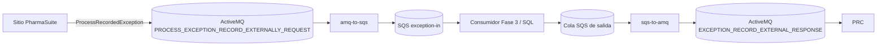
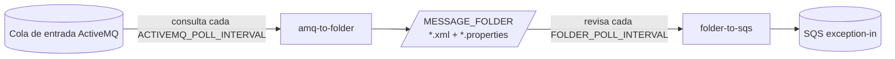

# Puente ActiveMQ ⇄ AWS SQS

*English version: [README.md](README.md)*

Dos contenedores independientes y configurables que mueven los mensajes de excepciones de PharmaSuite entre ActiveMQ (OpenWire nativo) y AWS SQS:

| Contenedor | Dirección | Origen por defecto | Destino por defecto |
|---|---|---|---|
| `amq-to-sqs` | Ingesta (Fase 2 de `PlanActiveMQ_a_SQL.md`) | ActiveMQ `PROCESS_EXCEPTION_RECORD_EXTERNALLY_REQUEST` | SQS `exception-in` |
| `sqs-to-amq` | Respuesta hacia PRC (Fase 5) | Cola SQS de salida (nombre por definir) | ActiveMQ `EXCEPTION_RECORD_EXTERNAL_RESPONSE` |



Cada sitio de PharmaSuite tiene su propio broker, así que se despliega **un par de contenedores por sitio**. Entre sitios solo cambian las variables de entorno: URL del broker, credenciales, `SITE_ID` y URLs de las colas SQS.

### Modo separado: `amq-to-folder` + `folder-to-sqs`

Cuando no hay Docker ni entorno de PharmaSuite disponibles para una demo integrada, la ingesta puede ejecutarse como **dos servicios separados** que se pasan los mensajes a través de una carpeta local:

| Servicio | Dónde se ejecuta | Qué hace |
|---|---|---|
| `amq-to-folder` (**servicio Local**) | Junto al broker | Consulta ActiveMQ cada `ACTIVEMQ_POLL_INTERVAL` (por defecto `5m`) y guarda cada mensaje XML como fichero en `MESSAGE_FOLDER` |
| `folder-to-sqs` (**servicio Pfizer**) | Donde haya acceso a AWS | Revisa `MESSAGE_FOLDER` cada `FOLDER_POLL_INTERVAL`, envía cada fichero a SQS y luego lo mueve a `processed/` |



Los dos son aplicaciones `java -jar` normales y no necesitan Docker. Los mensajes SQS son iguales a los que envía `amq-to-sqs`: mismos atributos, mismo grupo FIFO y mismo ID de deduplicación.

> **Estado:** `mvn package` genera todos los JARs. Una prueba de arranque confirmó que cada aplicación lee su configuración y se detiene con un error claro si falta una variable obligatoria. Los servicios separados se probaron en local de punta a punta contra un broker ActiveMQ 5.15 embebido y un endpoint SQS simulado. La prueba cubrió la consulta con el intervalo configurado, el paso por la carpeta, los reintentos con SQS caído y el rechazo permanente. **No se ha probado nada contra un broker real de PharmaSuite ni contra AWS SQS real**, y no se han construido ni ejecutado las imágenes Docker ni el stack de `docker compose`.

---

## Estructura del proyecto

```
activemq-sqs-bridge/
├── pom.xml                      # Maven padre (Java 17, activemq-client 5.15.0, AWS SDK v2)
├── bridge-common/               # Librería compartida
├── amq-to-sqs/                  # Contenedor 1: ActiveMQ -> SQS
│   └── Dockerfile
├── sqs-to-amq/                  # Contenedor 2: SQS -> ActiveMQ
│   └── Dockerfile
├── amq-to-folder/               # Modo separado, servicio Local: ActiveMQ -> carpeta
│   └── Dockerfile
├── folder-to-sqs/               # Modo separado, servicio Pfizer: carpeta -> SQS
│   └── Dockerfile
├── config/
│   ├── amq-to-sqs.env.example   # Plantilla de configuración por sitio
│   ├── sqs-to-amq.env.example
│   ├── amq-to-folder.env.example
│   └── folder-to-sqs.env.example
├── local/localstack-init/
│   └── create-queues.sh         # Crea las colas SQS y sus DLQ en LocalStack
└── docker-compose.yml           # Stack local de pruebas
```

`activemq-client` está fijado en **5.15.0** porque es la `ProviderVersion` que el broker de destino informó en su handshake OpenWire.

---

## Módulos

### `bridge-common`: librería compartida

Todos los servicios usan este módulo, así que la conexión, la configuración y los reintentos funcionan igual en todos.

| Clase | Responsabilidad |
|---|---|
| `EnvConfig` | Lee la configuración comprobando su tipo: `required`, `optional`, `intValue`, `longValue`, `boolValue`, `durationValue`. Los valores salen de variables de entorno y, opcionalmente, de un fichero `CLAVE=VALOR` indicado con `--config <fichero>` o `BRIDGE_CONFIG_FILE`. Las variables de entorno reales tienen prioridad sobre el fichero. Las duraciones aceptan `500ms`, `30s`, `5m`, `10m`, `1h`, `1h30m`, `1d` o ISO-8601 (`PT10M`). Un número sin unidad distinto de `0` se rechaza porque su unidad sería ambigua. Si falta un valor o no es válido, lanza `ConfigException` y la aplicación termina con código 2 antes de conectarse a nada. `secret(KEY)` también acepta `KEY_FILE`, para montar las contraseñas como secretos de Docker/Kubernetes en vez de pasarlas como variables. |
| `ActiveMqPoller` | El bucle de consumo de ActiveMQ compartido (sesión `INDIVIDUAL_ACKNOWLEDGE`, reconexión con espera). Su comportamiento depende de `ACTIVEMQ_POLL_INTERVAL`. Con `0` se queda conectado y consume de forma continua. Con un intervalo mayor que 0 se conecta, vacía todos los mensajes que haya en la cola, se desconecta y espera ese intervalo, así no retiene ningún mensaje precargado mientras espera. Lo usan `amq-to-sqs` y `amq-to-folder`. |
| `MessageMetadata` | Los metadatos JMS que acompañan a un mensaje (sitio, cola, ID JMS, timestamp, content type). Construye los atributos del mensaje SQS y lee/escribe los ficheros `.properties` asociados. |
| `MessageFolder` | El formato de la carpeta de intercambio. `write` crea `<timestamp>_<jmsId>.properties` y después `<timestamp>_<jmsId>.xml`. El XML se escribe en un `.tmp` y se renombra de forma atómica, así quien lee solo ve ficheros completos. El nombre sale del timestamp y el ID JMS, así que un mensaje reentregado no sobrescribe nada ni crea duplicados. `pending()` lista los `*.xml` del más antiguo al más nuevo. |
| `SqsPublisher`, `XmlInspector`, `FailedMessageStore` | Se describen más abajo, en `amq-to-sqs`. Están aquí para que `folder-to-sqs` use exactamente la misma lógica de SQS. |
| `ActiveMqSettings` | Construye el `ActiveMQConnectionFactory` a partir de las variables `ACTIVEMQ_*`. Envuelve automáticamente la URL en `failover:(...)`, así el cliente se reconecta con espera exponencial, y el `timeout` del failover hace que un envío bloqueado falle en vez de quedarse colgado. Con URLs `ssl://` usa `ActiveMQSslConnectionFactory`, con truststore y keystore opcionales (para TLS mutuo). Fija prefetch = 1, así nunca hay más de un mensaje sin confirmar en memoria, y una política de reentrega ilimitada, para que el cliente nunca mande un mensaje a la DLQ del broker. Desactiva los advisory topics, que suelen necesitar permisos extra en el broker. `describe()` devuelve un resumen apto para logs, sin contraseñas. |
| `SqsSettings` | Construye el `SqsClient` del AWS SDK v2 a partir de `AWS_REGION`, `SQS_QUEUE_URL` y, opcionalmente, `SQS_ENDPOINT_OVERRIDE` (para LocalStack o un endpoint de VPC). Las credenciales salen de la **cadena estándar de credenciales de AWS** (variables de entorno, `AWS_PROFILE`, web identity, rol del contenedor o de la instancia), así que el código nunca maneja secretos. Trata la cola como FIFO cuando la URL termina en `.fifo`. También respeta `AWS_ACCESS_KEY_ID`/`AWS_SECRET_ACCESS_KEY`/`AWS_SESSION_TOKEN` o `AWS_PROFILE` puestos en un fichero `--config`, porque el SDK por sí solo solo ve las variables de entorno reales. |
| `Backoff` | Espera exponencial con jitter (`RETRY_INITIAL_DELAY_MS`, `RETRY_MAX_DELAY_MS`). Se usa en todos los bucles de reconexión y reintento. |
| `BridgeRunner` | Ejecuta el bucle del puente en el hilo principal y registra un shutdown hook. Al recibir SIGTERM/SIGINT (`docker stop`) le indica al bucle que pare y espera hasta `SHUTDOWN_GRACE_MS` a que termine el trabajo en curso. |
| `simplelogger.properties` | Escribe los logs en stdout con fecha y nombre del hilo. Baja a `warn` los mensajes del AWS SDK y del cliente HTTP para reducir ruido. |

### `amq-to-sqs`: contenedor de ingesta

Consume la cola de entrada de ActiveMQ, un mensaje cada vez, y reenvía cada mensaje a SQS. Por defecto consume de forma continua. Si se configura `ACTIVEMQ_POLL_INTERVAL` (p. ej. `5m`), consulta la cola cada ese intervalo.

| Clase | Responsabilidad |
|---|---|
| `AmqToSqsApp` | Punto de entrada. Lee y valida la configuración, escribe en el log un resumen sin secretos, conecta los componentes y arranca `BridgeRunner`. |
| `AmqToSqsBridge` | Manejador de mensajes de `ActiveMqPoller`. Recibe un mensaje, lo inspecciona, lo envía a SQS y solo entonces **lo confirma a ActiveMQ**. Si SQS falla con un error transitorio, reintenta con espera todo el tiempo que haga falta. Mientras reintenta no consume nada nuevo, lo que frena el flujo de forma natural. Si se cae la conexión con ActiveMQ, la reconstruye con espera. Al apagarse, el mensaje que aún no se ha reenviado queda sin confirmar, así que el broker lo vuelve a entregar. Lee `TextMessage` y `BytesMessage` (como UTF-8). Cualquier otro tipo de mensaje va al almacén de mensajes fallidos. |
| `SqsPublisher` | Envía un mensaje a SQS. **Rechaza de forma permanente** un cuerpo vacío, un cuerpo mayor que `SQS_MAX_MESSAGE_BYTES` o un mensaje que SQS rechaza con un código no reintentable (`InvalidMessageContents`, `InvalidParameterValue`, …). Cualquier otra `SdkException` se considera transitoria. En colas FIFO usa `MessageGroupId = SITE_ID` y `MessageDeduplicationId = sha256(SITE_ID + JMSMessageID)`, así que SQS descarta una reentrega JMS que llegue dentro de su ventana de deduplicación de 5 minutos. |
| `XmlInspector` | Analiza el contenido con un parser DOM protegido contra XXE: DOCTYPE prohibido, procesamiento seguro activado y acceso externo bloqueado. Extrae `PSUniqueExceptionID`. Si `XSD_PATH` apunta a `RAExternalExceptionHandling.xsd`, también valida el contenido. La inspección **nunca bloquea el reenvío**: un contenido inválido o que no es XML se envía igualmente con `SchemaValid=false`, y el consumidor posterior decide qué hacer con él. |
| `FailedMessageStore` | Almacén de último recurso para los mensajes que SQS rechaza de forma permanente. Escribe `<timestamp>_<jmsId>.msg` (el cuerpo) y un fichero `.reason.txt` en `FAILED_MESSAGE_DIR` (por defecto `/data/failed`; móntalo como volumen), y solo después confirma el mensaje. El broker no guarda los mensajes (solo tienen un tiempo de vida), así que descartarlos supondría perder datos. El ID del mensaje se limpia antes de usarlo como nombre de fichero, para evitar path traversal. |

**Atributos que se añaden al mensaje SQS:**

| Atributo | Valor |
|---|---|
| `SourceSite` | `SITE_ID` (se usa para el etiquetado de S2) |
| `SourceQueue` | Nombre de la cola de ActiveMQ |
| `JmsMessageId` | ID original del mensaje JMS |
| `JmsTimestamp` | Timestamp JMS (Number) |
| `ContentType` | Propiedad JMS `ContentType`, o `text/xml` si no existe |
| `PSUniqueExceptionID` | Extraído del XML, si está presente |
| `SchemaValid` | `true`/`false`; solo se incluye si `XSD_PATH` está configurado |

### `sqs-to-amq`: contenedor de respuesta

Lee una cola SQS con long polling y publica cada mensaje en la cola de salida de ActiveMQ.

| Clase | Responsabilidad |
|---|---|
| `SqsToAmqApp` | Punto de entrada. Prepara la petición `ReceiveMessageRequest` (tamaño de lote, espera de long polling, visibility timeout opcional, todos los atributos) y el publicador, y arranca el puente. |
| `SqsToAmqBridge` | Bucle principal. Recibe un lote, publica cada mensaje en ActiveMQ y **solo lo borra de SQS cuando el broker lo ha aceptado**. Si la publicación falla, reinicia la conexión con ActiveMQ, espera y deja de procesar el lote actual. Los mensajes restantes vuelven a estar visibles cuando vence el visibility timeout y, tras el `maxReceiveCount` de la cola, pasan a la DLQ de SQS (la redrive policy se configura en AWS). Si el borrado falla después de una publicación correcta, escribe un aviso en el log, porque el mensaje se volverá a entregar como duplicado. Los atributos SQS de tipo String/Number se convierten en propiedades JMS de tipo string; sus nombres se ajustan para que sean identificadores Java válidos y nunca empiecen por el prefijo reservado `JMS`. Añade `SqsMessageId`, y `ContentType` vale `text/xml` por defecto. |
| `ActiveMqPublisher` | Productor que se conecta solo cuando hace falta y se reconecta si se pierde la conexión. Los envíos persistentes (la opción por defecto) son síncronos: `send()` solo devuelve el control cuando el broker ha aceptado el mensaje. Admite un tiempo de vida (TTL) opcional para el mensaje. |

### `amq-to-folder`: servicio Local (modo separado)

Consulta la cola de entrada de ActiveMQ y guarda cada mensaje como fichero XML.

| Clase | Responsabilidad |
|---|---|
| `AmqToFolderApp` | Punto de entrada. Lee la configuración (`ACTIVEMQ_POLL_INTERVAL` vale `5m` por defecto), escribe un resumen sin secretos y arranca `BridgeRunner`. |
| `AmqToFolderBridge` | Manejador de mensajes de `ActiveMqPoller`. Escribe el mensaje con `MessageFolder` y **solo lo confirma a ActiveMQ cuando el fichero está guardado en disco**. Si la escritura falla (disco lleno, carpeta de red caída), reintenta con espera y no consume nada nuevo. Los tipos de mensaje que no son Text/Bytes van al almacén de mensajes fallidos y se confirman. Cada consulta escribe `Poll of <cola> finished: N message(s); next poll in <intervalo>`. |

### `folder-to-sqs`: servicio Pfizer (modo separado)

Revisa la carpeta y envía cada fichero XML a SQS, del más antiguo al más nuevo.

| Clase | Responsabilidad |
|---|---|
| `FolderToSqsApp` | Punto de entrada. Lee la configuración, escribe un resumen sin secretos y arranca `BridgeRunner`. |
| `FolderToSqsBridge` | Bucle de revisión. Para cada `*.xml` lee el cuerpo y su `.properties`, inspecciona el XML y lo envía con `SqsPublisher`. Tras un envío correcto mueve el fichero y su `.properties` a `PROCESSED_DIR`, o los borra si `DELETE_AFTER_SEND=true`. Si SQS falla con un error transitorio, reintenta el mismo fichero con espera, así se mantiene el orden. Un fichero que SQS rechaza de forma permanente se guarda en `FAILED_MESSAGE_DIR` con un `.reason.txt` y se quita de la carpeta. Un fichero sin `.properties` (por ejemplo, copiado a mano) se envía igualmente, usando `SITE_ID` y `ACTIVEMQ_QUEUE` como `SourceSite`/`SourceQueue`. |

Si `folder-to-sqs` se detiene entre el envío a SQS y el movimiento del fichero, el fichero se vuelve a enviar en la siguiente revisión. En una cola FIFO el ID de deduplicación es el mismo, así que SQS descarta la copia dentro de su ventana de 5 minutos.

### Garantías de entrega

Los dos sentidos son **at-least-once**: un mensaje no debería perderse, pero puede llegar dos veces. Por eso sigue haciendo falta la comprobación de duplicados de la Fase 3.2 en el consumidor. Las colas FIFO reducen los duplicados en el lado de SQS, pero solo dentro de la ventana de deduplicación de 5 minutos.

### Limitaciones conocidas

- Durante una caída del broker, una conexión o un envío pueden quedarse bloqueados hasta que vence el `timeout` del failover (30 s por defecto), antes de que el puente reaccione o se apague.
- `sqs-to-amq` no valida el contenido, porque el esquema de respuesta de PRC todavía no está definido (Fase 5.2).

---

## Referencia de configuración

Toda la configuración se hace con variables de entorno o con un fichero de configuración. Las plantillas son [config/amq-to-sqs.env.example](config/amq-to-sqs.env.example), [config/sqs-to-amq.env.example](config/sqs-to-amq.env.example), [config/amq-to-folder.env.example](config/amq-to-folder.env.example) y [config/folder-to-sqs.env.example](config/folder-to-sqs.env.example).
**Nota:** `docker --env-file` no admite comentarios en la misma línea que un valor. Pon cada comentario en su propia línea.

**Fichero de configuración:** sin Docker, pasa el mismo fichero `CLAVE=VALOR` con `--config <fichero>`, o define `BRIDGE_CONFIG_FILE=<fichero>`. Las variables de entorno reales tienen prioridad sobre el fichero. Así, ajustes como el intervalo de consulta quedan fuera del código. Para pasar la consulta de ActiveMQ de 5 a 10 minutos, pon `ACTIVEMQ_POLL_INTERVAL=10m` en el fichero y reinicia el servicio.

### Comunes (ambos contenedores)

| Variable | Obligatoria | Por defecto | Descripción |
|---|---|---|---|
| `ACTIVEMQ_URL` | sí | — | p. ej. `tcp://aznaampstalos1i:61646` o `ssl://host:61647` |
| `ACTIVEMQ_QUEUE` | no | cola de entrada/salida | Cola de la que se consume o en la que se publica |
| `ACTIVEMQ_USER` | no | anónimo | Usuario del broker |
| `ACTIVEMQ_PASSWORD` / `ACTIVEMQ_PASSWORD_FILE` | no | — | Contraseña del broker |
| `ACTIVEMQ_USE_FAILOVER` | no | `true` | Envolver la URL en `failover:(...)` |
| `ACTIVEMQ_FAILOVER_OPTIONS` | no | `initialReconnectDelay=1000&maxReconnectDelay=30000&useExponentialBackOff=true&timeout=30000` | Opciones del transporte failover |
| `ACTIVEMQ_SSL_TRUSTSTORE` / `_PASSWORD` | para `ssl://` | — | Ruta y contraseña del truststore |
| `ACTIVEMQ_SSL_KEYSTORE` / `_PASSWORD` | solo TLS mutuo | — | Keystore del cliente |
| `ACTIVEMQ_MAX_REDELIVERIES` | no | `-1` | Política de reentrega del cliente (`-1` = ilimitada) |
| `AWS_REGION` | sí | — | Región de AWS |
| `SQS_QUEUE_URL` | sí | — | Cola de destino (`amq-to-sqs`) o de origen (`sqs-to-amq`) |
| `SQS_ENDPOINT_OVERRIDE` | no | — | LocalStack o endpoint de VPC |
| Credenciales AWS | sí | — | Cadena estándar: `AWS_ACCESS_KEY_ID`/`AWS_SECRET_ACCESS_KEY`, `AWS_PROFILE`, rol, … |
| `RETRY_INITIAL_DELAY_MS` / `RETRY_MAX_DELAY_MS` | no | `1000` / `60000` | Límites de la espera entre reintentos |
| `SHUTDOWN_GRACE_MS` | no | `15000` / `30000` | Tiempo que el apagado espera al trabajo en curso |
| `JAVA_OPTS` | no | `-XX:MaxRAMPercentage=75` | Opciones de la JVM. La JVM ignora `HTTPS_PROXY`; para usar un proxy, pasa aquí `-Dhttps.proxyHost=... -Dhttps.proxyPort=...`. |

### Solo `amq-to-sqs`

| Variable | Obligatoria | Por defecto | Descripción |
|---|---|---|---|
| `SITE_ID` | sí | — | Código del sitio que se añade a cada mensaje |
| `XSD_PATH` | no | — | Ruta a `RAExternalExceptionHandling.xsd` |
| `SQS_MAX_MESSAGE_BYTES` | no | `262144` | Los cuerpos más grandes van al almacén de mensajes fallidos |
| `FAILED_MESSAGE_DIR` | no | `/data/failed` | Almacén de mensajes fallidos (montar como volumen) |
| `ACTIVEMQ_RECEIVE_TIMEOUT_MS` | no | `1000` | Intervalo de espera de cada lectura (también limita lo que tarda el apagado) |
| `ACTIVEMQ_POLL_INTERVAL` | no | `0` | `0` = consumo continuo. Una duración (p. ej. `5m`, `10m`) = vaciar la cola, desconectarse y esperar ese tiempo |

### Solo `amq-to-folder`

También usa las variables comunes `ACTIVEMQ_*`, `RETRY_*` y `SHUTDOWN_GRACE_MS`.

| Variable | Obligatoria | Por defecto | Descripción |
|---|---|---|---|
| `SITE_ID` | sí | — | Código del sitio que se guarda en los metadatos de cada mensaje |
| `ACTIVEMQ_POLL_INTERVAL` | no | `5m` | Cada cuánto se consulta ActiveMQ (`ms`, `s`, `m`, `h`, `d`, combinaciones como `1h30m`, o ISO `PT10M`). `0` = consumo continuo |
| `ACTIVEMQ_RECEIVE_TIMEOUT_MS` | no | `1000` | Cuánto espera una lectura al siguiente mensaje antes de dar la consulta por terminada |
| `MESSAGE_FOLDER` | no | `/data/messages` | Dónde se escriben los XML y sus `.properties` |
| `FAILED_MESSAGE_DIR` | no | `/data/failed` | Mensajes JMS que no son Text/Bytes |

### Solo `folder-to-sqs`

También usa las variables comunes `AWS_*`, `SQS_*`, `RETRY_*` y `SHUTDOWN_GRACE_MS`. No usa ActiveMQ.

| Variable | Obligatoria | Por defecto | Descripción |
|---|---|---|---|
| `SITE_ID` | sí | — | `MessageGroupId` FIFO, y `SourceSite` para ficheros sin `.properties` |
| `MESSAGE_FOLDER` | no | `/data/messages` | Carpeta que escribe `amq-to-folder` |
| `FOLDER_POLL_INTERVAL` | no | `30s` | Cada cuánto se revisa la carpeta (mismo formato que `ACTIVEMQ_POLL_INTERVAL`) |
| `PROCESSED_DIR` | no | `<MESSAGE_FOLDER>/processed` | Adónde se mueven los ficheros enviados |
| `DELETE_AFTER_SEND` | no | `false` | Borrar los ficheros enviados en vez de moverlos |
| `FAILED_MESSAGE_DIR` | no | `/data/failed` | Ficheros que SQS rechaza de forma permanente |
| `ACTIVEMQ_QUEUE` | no | `PROCESS_EXCEPTION_RECORD_EXTERNALLY_REQUEST` | `SourceQueue` para ficheros sin `.properties` |
| `XSD_PATH` | no | — | Ruta a `RAExternalExceptionHandling.xsd` |
| `SQS_MAX_MESSAGE_BYTES` | no | `262144` | Los ficheros más grandes van al almacén de mensajes fallidos |

### Solo `sqs-to-amq`

| Variable | Obligatoria | Por defecto | Descripción |
|---|---|---|---|
| `SQS_MAX_MESSAGES` | no | `10` | Mensajes por lectura (1–10) |
| `SQS_WAIT_TIME_SECONDS` | no | `20` | Tiempo de espera del long polling |
| `SQS_VISIBILITY_TIMEOUT_SECONDS` | no | el de la cola | Sobrescribe el visibility timeout |
| `ACTIVEMQ_PERSISTENT` | no | `true` | Entrega persistente (síncrona) |
| `ACTIVEMQ_MESSAGE_TTL_MS` | no | `0` | Tiempo de vida JMS (`0` = no caduca) |

### Permisos IAM mínimos

- `amq-to-sqs` y `folder-to-sqs`: `sqs:SendMessage` sobre `exception-in`.
- `sqs-to-amq`: `sqs:ReceiveMessage` y `sqs:DeleteMessage` sobre la cola de salida.
- Si las colas usan SSE-KMS: `kms:GenerateDataKey` (quien envía) y `kms:Decrypt` (quien recibe) sobre esa clave.

---

## Compilar y ejecutar

```bash
# Compilar los JARs (Java 17 + Maven)
mvn -B package

# Construir las imágenes (el contexto de build es esta carpeta)
docker build -f amq-to-sqs/Dockerfile -t amq-to-sqs:1.0.0 .
docker build -f sqs-to-amq/Dockerfile -t sqs-to-amq:1.0.0 .

# Ejecutar contra un broker real (un fichero env por sitio)
cp config/amq-to-sqs.env.example andover.env   # rellenar los valores
docker run -d --name amq-to-sqs-andover --env-file andover.env -v amq-failed-andover:/data/failed amq-to-sqs:1.0.0
```

Los contenedores se ejecutan con un usuario sin privilegios (UID 10001).

### Modo separado sin Docker

Para ejecutarlo solo hace falta Java 17. Copia cada plantilla, rellena los valores y arranca cada servicio con su fichero:

```bash
mvn -B package
cp config/amq-to-folder.env.example config/local.env    # ActiveMQ, ACTIVEMQ_POLL_INTERVAL, MESSAGE_FOLDER
cp config/folder-to-sqs.env.example config/pfizer.env   # AWS, la misma MESSAGE_FOLDER

# Servicio Local: consulta ActiveMQ y escribe ./data/messages/*.xml
java -jar amq-to-folder/target/amq-to-folder.jar --config config/local.env

# Servicio Pfizer: envía ./data/messages/*.xml a SQS y los mueve a ./data/messages/processed
java -jar folder-to-sqs/target/folder-to-sqs.jar --config config/pfizer.env
```

Los dos servicios solo comparten la carpeta, así que pueden ejecutarse en momentos distintos o en máquinas distintas (copiando o sincronizando la carpeta). Para cambiar la frecuencia de consulta, edita `ACTIVEMQ_POLL_INTERVAL` en `config/local.env` (p. ej. `5m` → `10m`) y reinicia el servicio Local. También puedes cambiarla para una sola ejecución sin tocar el fichero: `ACTIVEMQ_POLL_INTERVAL=10m java -jar ...`, o `$env:ACTIVEMQ_POLL_INTERVAL="10m"` en PowerShell.

Con Docker, el mismo par está disponible en el stack de compose: `docker compose --profile split up --build activemq localstack amq-to-folder folder-to-sqs`.

---

## Pruebas

> **Aviso:** `amq-to-sqs` **saca** los mensajes de la cola de entrada. En un broker compartido (el entorno de validación de Justin o la instancia de Rockwell), otras personas dejarán de ver esos mensajes. Coordínalo con ellos antes de apuntarlo ahí.

### 1. Levantar el stack local

El dev container actual no tiene Docker, así que ejecútalo en una máquina que sí lo tenga:

```bash
cd activemq-sqs-bridge
docker compose up --build -d
docker compose logs -f amq-to-sqs
# debe aparecer: "Connected, consuming from PROCESS_EXCEPTION_RECORD_EXTERNALLY_REQUEST"
```

El stack levanta ActiveMQ 5.15.9 (OpenWire en `61616`, consola web en `8161`, admin/admin), LocalStack SQS en `4566` con las colas `exception-in`, `exception-out` y sus DLQ, y los dos puentes.

### 2. Publicar un mensaje en ActiveMQ

Elige una de estas opciones:

- **Consola web:** entra en http://localhost:8161/admin, abre **Send**, pon como destino `PROCESS_EXCEPTION_RECORD_EXTERNALLY_REQUEST`, pega el contenido de `ProcessRecordedException.xml` y pulsa **Send**. En la instancia de Rockwell la página es `http://aznaampstalos1d.ra-int.com:8162/admin/send.jsp`.
- **API REST de ActiveMQ:**
  ```bash
  curl -u admin:admin --data-urlencode "body@ProcessRecordedException.xml" \
    "http://localhost:8161/api/message/PROCESS_EXCEPTION_RECORD_EXTERNALLY_REQUEST?type=queue"
  ```
- **Prueba real de punta a punta:** crea una excepción en PharmaSuite (`PlantOperations` en la instancia de Rockwell). `ActivateExternalExceptionHandling` tiene que estar activado, y el Risk Class de la excepción tiene que ser igual o superior a `MinimalRiskClassForExternalExceptionHandling`.

### 3. Comprobar que funcionó

- En los logs: `Forwarded JMS ID:... (PSUniqueExceptionID=...) -> SQS <id>`.
- En la consola de ActiveMQ: la cola muestra *Pending* = 0 y el contador *Dequeued* sube en 1.
- En SQS:
  ```bash
  docker compose exec localstack awslocal sqs receive-message \
    --queue-url http://localhost:4566/000000000000/exception-in --message-attribute-names All
  ```

### 4. Probar el sentido contrario

```bash
docker compose exec localstack awslocal sqs send-message \
  --queue-url http://localhost:4566/000000000000/exception-out --message-body '<test/>'
```

Después, en la consola de ActiveMQ, abre **Browse** en `EXCEPTION_RECORD_EXTERNAL_RESPONSE`. El mensaje debe aparecer ahí.

### 5. Pruebas de resiliencia (opcional)

- Ejecuta `docker compose stop localstack`, publica un mensaje y luego `docker compose start localstack`. El mensaje debe llegar a SQS cuando LocalStack vuelva.
- Ejecuta `docker compose restart activemq`. Los dos puentes deben reconectarse solos.
- Publica un cuerpo mayor que `SQS_MAX_MESSAGE_BYTES`. Debe aparecer en el volumen `failed-messages`.

---

## Información que falta

Nada de esto está definido en `PlanActiveMQ_a_SQL.md`.

**AWS**
1. Región y número de cuenta de AWS, y la URL exacta de la cola `exception-in`. También si la cola es estándar o FIFO.
2. Nombre de la cola SQS de salida de la Fase 5. Como cada sitio tiene su propio broker, hace falta **una cola de salida por sitio** (p. ej. `exception-out-andover`) o una regla que decida a qué sitio va cada mensaje.
3. DLQs de `exception-in` y de la cola de salida, y cuántos intentos de lectura se permiten antes de mover un mensaje a la DLQ (`maxReceiveCount` de la redrive policy).
4. Cómo se autentica el servidor on-prem contra AWS: IAM Roles Anywhere (recomendado), claves de un usuario IAM o un perfil.
5. Políticas IAM (ver *Permisos IAM mínimos*), y la clave KMS si las colas están cifradas.
6. Cómo sale el tráfico de la red on-prem hacia AWS: salida a internet por proxy, Direct Connect/VPN o un endpoint de VPC.
7. Dónde se ejecutarán los contenedores en cada sitio (servidor y orquestador).

**Pfizer / ActiveMQ**

8. El código `SITE_ID` de cada sitio (Andover, Grange Castle DP, Sanford).
9. URL del broker de producción de cada sitio (`ssl`/61647) y sus certificados TLS (truststore, y keystore si se exige TLS mutuo).
10. Puerto OpenWire de la instancia de Rockwell. El `:8162` que tenemos es solo la consola web.
11. El fichero `RAExternalExceptionHandling.xsd`. Es opcional; se configura con `XSD_PATH`.
12. El formato que espera PRC en la respuesta, y la confirmación de que `EXCEPTION_RECORD_EXTERNAL_RESPONSE` es la cola correcta (Fase 5.1–5.2).
13. Volumen de mensajes esperado por sitio. Decide si basta con un consumidor por sitio.
