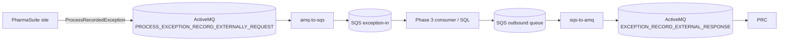
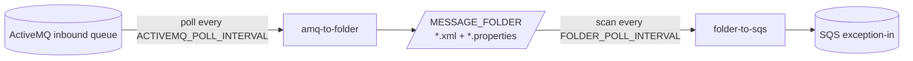

# ActiveMQ ⇄ AWS SQS Bridge

*Spanish version: [README.es.md](README.es.md)*

Two independent, configurable containers that move PharmaSuite exception messages between ActiveMQ (native OpenWire) and AWS SQS:

| Container | Direction | Default source | Default target |
|---|---|---|---|
| `amq-to-sqs` | Ingestion (Phase 2 of `PlanActiveMQ_a_SQL.md`) | ActiveMQ `PROCESS_EXCEPTION_RECORD_EXTERNALLY_REQUEST` | SQS `exception-in` |
| `sqs-to-amq` | Push-back to PRC (Phase 5) | SQS outbound queue (name TBD) | ActiveMQ `EXCEPTION_RECORD_EXTERNAL_RESPONSE` |



Each PharmaSuite site has its own broker, so you deploy **one pair of containers per site**. The sites differ only in their environment variables: broker URL, credentials, `SITE_ID` and SQS queue URLs.

### Split mode: `amq-to-folder` + `folder-to-sqs`

When Docker and the PharmaSuite environment are not available for an integrated demo, the ingestion direction can run as **two separate services** that hand off through a local folder:

| Service | Runs on | Does |
|---|---|---|
| `amq-to-folder` (**Local service**) | Next to the broker | Polls ActiveMQ every `ACTIVEMQ_POLL_INTERVAL` (default `5m`) and saves each XML message as a file in `MESSAGE_FOLDER` |
| `folder-to-sqs` (**Pfizer service**) | Wherever AWS is reachable | Scans `MESSAGE_FOLDER` every `FOLDER_POLL_INTERVAL` and pushes each file to SQS, then moves it to `processed/` |



Both are plain `java -jar` applications and need no Docker. The SQS messages are the same as the ones `amq-to-sqs` sends: same attributes, same FIFO group and deduplication ID.

> **Status:** `mvn package` builds all JARs. A startup smoke test confirmed that each app reads its configuration and stops with a clear error if a required variable is missing. The split services were tested locally end-to-end against an embedded ActiveMQ 5.15 broker and a mock SQS endpoint. That test covered polling with the configured interval, the folder hand-off, SQS retry while the endpoint was down, and permanent rejection. **Nothing has been tested against a real PharmaSuite broker or real AWS SQS**, and the Docker images and `docker compose` stack have not been built or run.

---

## Project layout

```
activemq-sqs-bridge/
├── pom.xml                      # Maven parent (Java 17, activemq-client 5.15.0, AWS SDK v2)
├── bridge-common/               # Shared library
├── amq-to-sqs/                  # Container 1: ActiveMQ -> SQS
│   └── Dockerfile
├── sqs-to-amq/                  # Container 2: SQS -> ActiveMQ
│   └── Dockerfile
├── amq-to-folder/               # Split mode, Local service: ActiveMQ -> folder
│   └── Dockerfile
├── folder-to-sqs/               # Split mode, Pfizer service: folder -> SQS
│   └── Dockerfile
├── config/
│   ├── amq-to-sqs.env.example   # Per-site configuration template
│   ├── sqs-to-amq.env.example
│   ├── amq-to-folder.env.example
│   └── folder-to-sqs.env.example
├── local/localstack-init/
│   └── create-queues.sh         # Creates local SQS queues + DLQs in LocalStack
└── docker-compose.yml           # Local test stack
```

`activemq-client` is pinned to **5.15.0** because that is the `ProviderVersion` the target broker reported in its OpenWire handshake.

---

## Modules

### `bridge-common` — shared library

All services use this module, so connection handling, configuration and retry behaviour are the same everywhere.

| Class | Responsibility |
|---|---|
| `EnvConfig` | Reads settings with type checks: `required`, `optional`, `intValue`, `longValue`, `boolValue`, `durationValue`. Settings come from environment variables and, optionally, a `KEY=VALUE` file passed with `--config <file>` or `BRIDGE_CONFIG_FILE`. Real environment variables override the file. Durations accept `500ms`, `30s`, `5m`, `10m`, `1h`, `1h30m`, `1d` or ISO-8601 (`PT10M`). A bare number other than `0` is rejected because its unit would be ambiguous. A missing or invalid value raises a `ConfigException`, and the app exits with code 2 before it connects to anything. `secret(KEY)` also supports `KEY_FILE`, so passwords can be mounted as Docker/Kubernetes secrets instead of plain env vars. |
| `ActiveMqPoller` | The shared ActiveMQ consume loop (`INDIVIDUAL_ACKNOWLEDGE` session, reconnect with backoff). Its behaviour depends on `ACTIVEMQ_POLL_INTERVAL`. With `0` it stays connected and consumes continuously. With an interval greater than 0 it connects, drains every message currently in the queue, disconnects and sleeps for the interval, so no prefetched message is held while it sleeps. Used by `amq-to-sqs` and `amq-to-folder`. |
| `MessageMetadata` | The JMS metadata that travels with a message (site, queue, JMS ID, timestamp, content type). It builds the SQS message attributes and reads/writes the `.properties` sidecar files. |
| `MessageFolder` | The folder hand-off format. `write` creates `<timestamp>_<jmsId>.properties` and then `<timestamp>_<jmsId>.xml`. The XML is written to a `.tmp` file and atomically renamed, so readers only ever see complete files. The name comes from the JMS timestamp and ID, so a redelivered message overwrites nothing and creates no duplicate. `pending()` lists the `*.xml` files oldest first. |
| `SqsPublisher`, `XmlInspector`, `FailedMessageStore` | Described under `amq-to-sqs` below. They live here so that `folder-to-sqs` uses exactly the same SQS logic. |
| `ActiveMqSettings` | Builds the `ActiveMQConnectionFactory` from `ACTIVEMQ_*` variables. It automatically wraps the URL in `failover:(...)` so the client reconnects with exponential backoff, and the failover `timeout` makes a blocked send fail instead of hanging forever. For `ssl://` URLs it uses `ActiveMQSslConnectionFactory` with an optional truststore and keystore (for mutual TLS). It sets prefetch = 1, so at most one unacknowledged message is held in memory, and an unlimited redelivery policy, so the client never poison-acks a message to the broker's DLQ. It turns off advisory topics, which often need extra broker permissions. `describe()` returns a log-safe summary with no passwords. |
| `SqsSettings` | Builds the AWS SDK v2 `SqsClient` from `AWS_REGION`, `SQS_QUEUE_URL` and an optional `SQS_ENDPOINT_OVERRIDE` (for LocalStack or a VPC interface endpoint). Credentials come from the **AWS default credentials chain** (env vars, `AWS_PROFILE`, web identity, container/instance role), so the code never handles secrets. It treats the queue as FIFO when the URL ends in `.fifo`. `AWS_ACCESS_KEY_ID`/`AWS_SECRET_ACCESS_KEY`/`AWS_SESSION_TOKEN` or `AWS_PROFILE` set in a `--config` file are also honoured, because the SDK itself only sees real environment variables. |
| `Backoff` | Exponential backoff with jitter (`RETRY_INITIAL_DELAY_MS`, `RETRY_MAX_DELAY_MS`), used for every reconnect and retry loop. |
| `BridgeRunner` | Runs the bridge loop on the main thread and registers a shutdown hook. On SIGTERM/SIGINT (`docker stop`) it signals the loop to stop and waits up to `SHUTDOWN_GRACE_MS` for in-flight work to finish. |
| `simplelogger.properties` | Logs to stdout with timestamps and thread names. AWS SDK and HTTP client noise is lowered to `warn`. |

### `amq-to-sqs` — ingestion container

It consumes the ActiveMQ inbound queue one message at a time and forwards each message to SQS. By default it consumes continuously. Set `ACTIVEMQ_POLL_INTERVAL` (e.g. `5m`) to poll instead.

| Class | Responsibility |
|---|---|
| `AmqToSqsApp` | Entry point. Reads and validates the configuration, logs a safe summary, wires the components together and starts `BridgeRunner`. |
| `AmqToSqsBridge` | Message handler for `ActiveMqPoller`. It receives a message, inspects it, sends it to SQS and only then **acknowledges it to ActiveMQ**. If SQS fails with a transient error, it retries with backoff for as long as needed. While it retries, nothing new is consumed, which acts as natural back-pressure. If the ActiveMQ connection breaks, it rebuilds it with backoff. On shutdown, any message not yet forwarded stays unacknowledged, so the broker redelivers it. Reads `TextMessage` and `BytesMessage` (as UTF-8). Other message types go to the failed-message store. |
| `SqsPublisher` | Sends one message to SQS. It **rejects permanently** an empty body, a body larger than `SQS_MAX_MESSAGE_BYTES`, or a message SQS refuses with a non-retryable error code (`InvalidMessageContents`, `InvalidParameterValue`, …). Every other `SdkException` counts as transient. For FIFO queues it sets `MessageGroupId = SITE_ID` and `MessageDeduplicationId = sha256(SITE_ID + JMSMessageID)`, so SQS drops a JMS redelivery that arrives within its 5-minute deduplication window. |
| `XmlInspector` | Parses the payload with an XXE-hardened DOM parser: DOCTYPE disallowed, secure processing on, external access blocked. It extracts `PSUniqueExceptionID`. If `XSD_PATH` points to `RAExternalExceptionHandling.xsd`, it also validates the payload. Inspection **never blocks forwarding**: an invalid or non-XML payload is still sent, with `SchemaValid=false`, and the downstream consumer decides what to do with it. |
| `FailedMessageStore` | Last-resort store for messages SQS rejects permanently. It writes `<timestamp>_<jmsId>.msg` (the body) and a `.reason.txt` file to `FAILED_MESSAGE_DIR` (default `/data/failed`; mount it as a volume), and only then acknowledges the message. The broker does not persist messages (they only have a TTL), so dropping them would lose data. The message ID is sanitized before it is used as a file name, to prevent path traversal. |

**SQS message attributes added:**

| Attribute | Value |
|---|---|
| `SourceSite` | `SITE_ID` (used for S2 tagging) |
| `SourceQueue` | ActiveMQ queue name |
| `JmsMessageId` | Original JMS message ID |
| `JmsTimestamp` | JMS timestamp (Number) |
| `ContentType` | JMS `ContentType` property, or `text/xml` if absent |
| `PSUniqueExceptionID` | Extracted from the XML, if present |
| `SchemaValid` | `true`/`false`; only set when `XSD_PATH` is configured |

### `sqs-to-amq` — push-back container

It long-polls an SQS queue and publishes each message to the ActiveMQ outbound queue.

| Class | Responsibility |
|---|---|
| `SqsToAmqApp` | Entry point. Builds the `ReceiveMessageRequest` (batch size, long-poll wait, optional visibility timeout, all message attributes) and the publisher, then starts the bridge. |
| `SqsToAmqBridge` | Main loop. Receives a batch, publishes each message to ActiveMQ and **deletes it from SQS only after the broker accepted it**. If the publish fails, it resets the ActiveMQ connection, backs off and stops processing the current batch. The remaining messages become visible again after the visibility timeout, and after the queue's `maxReceiveCount` they move to the SQS DLQ (redrive policy configured on the AWS side). If the delete fails after a successful publish, it logs a warning, because the message will be delivered again as a duplicate. String/Number SQS attributes become JMS string properties, with names sanitized to valid Java identifiers that never start with the reserved `JMS` prefix. `SqsMessageId` is added, and `ContentType` defaults to `text/xml`. |
| `ActiveMqPublisher` | Producer that connects lazily and reconnects when needed. Persistent sends (the default) are synchronous: `send()` returns only after the broker accepted the message. Supports an optional message TTL. |

### `amq-to-folder` — Local service (split mode)

It polls the ActiveMQ inbound queue and saves each message as an XML file.

| Class | Responsibility |
|---|---|
| `AmqToFolderApp` | Entry point. Reads the configuration (`ACTIVEMQ_POLL_INTERVAL` defaults to `5m`), logs a safe summary and starts `BridgeRunner`. |
| `AmqToFolderBridge` | Message handler for `ActiveMqPoller`. It writes the message with `MessageFolder` and **acknowledges it to ActiveMQ only after the file is safely on disk**. If the write fails (disk full, share offline), it retries with backoff and nothing new is consumed. Message types other than Text/Bytes go to the failed-message store and are acknowledged. Each poll logs `Poll of <queue> finished: N message(s); next poll in <interval>`. |

### `folder-to-sqs` — Pfizer service (split mode)

It scans the folder and pushes each XML file to SQS, oldest first.

| Class | Responsibility |
|---|---|
| `FolderToSqsApp` | Entry point. Reads the configuration, logs a safe summary and starts `BridgeRunner`. |
| `FolderToSqsBridge` | Scan loop. For each `*.xml` file it reads the body and the `.properties` sidecar, inspects the XML and sends it with `SqsPublisher`. After a successful send it moves the file and its sidecar to `PROCESSED_DIR`, or deletes them if `DELETE_AFTER_SEND=true`. If SQS fails with a transient error, it retries the same file with backoff, so order is kept. A file SQS rejects permanently is saved in `FAILED_MESSAGE_DIR` with a `.reason.txt` and removed from the folder. A file without a sidecar (for example, dropped in by hand) is still sent, using `SITE_ID` and `ACTIVEMQ_QUEUE` as `SourceSite`/`SourceQueue`. |

If `folder-to-sqs` stops between the SQS send and the file move, the file is sent again on the next scan. On a FIFO queue the deduplication ID is the same, so SQS drops the copy within its 5-minute window.

### Delivery guarantees

Both directions are **at-least-once**: a message should not be lost, but it can arrive twice. The Phase 3.2 idempotency check is therefore still required downstream. FIFO queues reduce duplicates on the SQS side, but only within the 5-minute deduplication window.

### Known limitations

- During a broker outage, a connect or send can block until the failover `timeout` expires (30 s by default) before the bridge reacts or shuts down.
- `sqs-to-amq` does not validate the payload, because the PRC response schema is still undefined (Phase 5.2).

---

## Configuration reference

Every setting comes from environment variables or from a config file. The templates are [config/amq-to-sqs.env.example](config/amq-to-sqs.env.example), [config/sqs-to-amq.env.example](config/sqs-to-amq.env.example), [config/amq-to-folder.env.example](config/amq-to-folder.env.example) and [config/folder-to-sqs.env.example](config/folder-to-sqs.env.example).
**Note:** `docker --env-file` does not support inline comments. Put each comment on its own line.

**Config file:** without Docker, pass the same `KEY=VALUE` file with `--config <file>`, or set `BRIDGE_CONFIG_FILE=<file>`. Real environment variables override values from the file. Settings such as the poll interval therefore live outside the code. To change ActiveMQ polling from 5 to 10 minutes, set `ACTIVEMQ_POLL_INTERVAL=10m` in the file and restart the service.

### Common (both containers)

| Variable | Required | Default | Description |
|---|---|---|---|
| `ACTIVEMQ_URL` | yes | — | e.g. `tcp://aznaampstalos1i:61646` or `ssl://host:61647` |
| `ACTIVEMQ_QUEUE` | no | inbound/outbound queue | Queue to consume from / publish to |
| `ACTIVEMQ_USER` | no | anonymous | Broker user |
| `ACTIVEMQ_PASSWORD` / `ACTIVEMQ_PASSWORD_FILE` | no | — | Broker password |
| `ACTIVEMQ_USE_FAILOVER` | no | `true` | Wrap the URL in `failover:(...)` |
| `ACTIVEMQ_FAILOVER_OPTIONS` | no | `initialReconnectDelay=1000&maxReconnectDelay=30000&useExponentialBackOff=true&timeout=30000` | Failover transport options |
| `ACTIVEMQ_SSL_TRUSTSTORE` / `_PASSWORD` | for `ssl://` | — | Truststore path and password |
| `ACTIVEMQ_SSL_KEYSTORE` / `_PASSWORD` | mutual TLS only | — | Client keystore |
| `ACTIVEMQ_MAX_REDELIVERIES` | no | `-1` | Client redelivery policy (`-1` = unlimited) |
| `AWS_REGION` | yes | — | AWS region |
| `SQS_QUEUE_URL` | yes | — | Target queue (`amq-to-sqs`) or source queue (`sqs-to-amq`) |
| `SQS_ENDPOINT_OVERRIDE` | no | — | LocalStack or VPC interface endpoint |
| AWS credentials | yes | — | Default chain: `AWS_ACCESS_KEY_ID`/`AWS_SECRET_ACCESS_KEY`, `AWS_PROFILE`, role, … |
| `RETRY_INITIAL_DELAY_MS` / `RETRY_MAX_DELAY_MS` | no | `1000` / `60000` | Backoff bounds |
| `SHUTDOWN_GRACE_MS` | no | `15000` / `30000` | How long shutdown waits for in-flight work |
| `JAVA_OPTS` | no | `-XX:MaxRAMPercentage=75` | JVM options. The JVM ignores `HTTPS_PROXY`; to use a proxy, pass `-Dhttps.proxyHost=... -Dhttps.proxyPort=...` here. |

### `amq-to-sqs` only

| Variable | Required | Default | Description |
|---|---|---|---|
| `SITE_ID` | yes | — | Site code attached to every message |
| `XSD_PATH` | no | — | Path to `RAExternalExceptionHandling.xsd` |
| `SQS_MAX_MESSAGE_BYTES` | no | `262144` | Larger bodies go to the failed-message store |
| `FAILED_MESSAGE_DIR` | no | `/data/failed` | Failed-message store (mount as a volume) |
| `ACTIVEMQ_RECEIVE_TIMEOUT_MS` | no | `1000` | Receive poll interval (also bounds shutdown latency) |
| `ACTIVEMQ_POLL_INTERVAL` | no | `0` | `0` = consume continuously. A duration (e.g. `5m`, `10m`) = drain the queue, disconnect, sleep for that long |

### `amq-to-folder` only

Also uses the common `ACTIVEMQ_*`, `RETRY_*` and `SHUTDOWN_GRACE_MS` settings.

| Variable | Required | Default | Description |
|---|---|---|---|
| `SITE_ID` | yes | — | Site code written to each message's metadata |
| `ACTIVEMQ_POLL_INTERVAL` | no | `5m` | How often ActiveMQ is polled (`ms`, `s`, `m`, `h`, `d`, combinations like `1h30m`, or ISO `PT10M`). `0` = consume continuously |
| `ACTIVEMQ_RECEIVE_TIMEOUT_MS` | no | `1000` | How long a receive waits for the next message before the poll is considered finished |
| `MESSAGE_FOLDER` | no | `/data/messages` | Where the XML files and `.properties` sidecars are written |
| `FAILED_MESSAGE_DIR` | no | `/data/failed` | Messages that are not Text/Bytes JMS messages |

### `folder-to-sqs` only

Also uses the common `AWS_*`, `SQS_*`, `RETRY_*` and `SHUTDOWN_GRACE_MS` settings. It does not use ActiveMQ.

| Variable | Required | Default | Description |
|---|---|---|---|
| `SITE_ID` | yes | — | FIFO `MessageGroupId`, and `SourceSite` for files without a sidecar |
| `MESSAGE_FOLDER` | no | `/data/messages` | Folder written by `amq-to-folder` |
| `FOLDER_POLL_INTERVAL` | no | `30s` | How often the folder is scanned (same format as `ACTIVEMQ_POLL_INTERVAL`) |
| `PROCESSED_DIR` | no | `<MESSAGE_FOLDER>/processed` | Where sent files are moved |
| `DELETE_AFTER_SEND` | no | `false` | Delete sent files instead of moving them |
| `FAILED_MESSAGE_DIR` | no | `/data/failed` | Files SQS rejects permanently |
| `ACTIVEMQ_QUEUE` | no | `PROCESS_EXCEPTION_RECORD_EXTERNALLY_REQUEST` | `SourceQueue` for files without a sidecar |
| `XSD_PATH` | no | — | Path to `RAExternalExceptionHandling.xsd` |
| `SQS_MAX_MESSAGE_BYTES` | no | `262144` | Larger files go to the failed-message store |

### `sqs-to-amq` only

| Variable | Required | Default | Description |
|---|---|---|---|
| `SQS_MAX_MESSAGES` | no | `10` | Messages per receive (1–10) |
| `SQS_WAIT_TIME_SECONDS` | no | `20` | Long-poll wait time |
| `SQS_VISIBILITY_TIMEOUT_SECONDS` | no | queue default | Override the visibility timeout |
| `ACTIVEMQ_PERSISTENT` | no | `true` | Persistent (synchronous) delivery |
| `ACTIVEMQ_MESSAGE_TTL_MS` | no | `0` | JMS time-to-live (`0` = never expires) |

### Minimum IAM permissions

- `amq-to-sqs` and `folder-to-sqs`: `sqs:SendMessage` on `exception-in`.
- `sqs-to-amq`: `sqs:ReceiveMessage` and `sqs:DeleteMessage` on the outbound queue.
- If the queues use SSE-KMS: `kms:GenerateDataKey` (sender) and `kms:Decrypt` (receiver) on that key.

---

## Build and run

```bash
# Build the JARs (Java 17 + Maven)
mvn -B package

# Build the images (the build context is this folder)
docker build -f amq-to-sqs/Dockerfile -t amq-to-sqs:1.0.0 .
docker build -f sqs-to-amq/Dockerfile -t sqs-to-amq:1.0.0 .

# Run against a real broker (one env file per site)
cp config/amq-to-sqs.env.example andover.env   # fill in the values
docker run -d --name amq-to-sqs-andover --env-file andover.env -v amq-failed-andover:/data/failed amq-to-sqs:1.0.0
```

The containers run as a non-root user (UID 10001).

### Split mode without Docker

Only Java 17 is needed at run time. Copy each template, fill in the values, and start each service with its own file:

```bash
mvn -B package
cp config/amq-to-folder.env.example config/local.env    # ActiveMQ settings, ACTIVEMQ_POLL_INTERVAL, MESSAGE_FOLDER
cp config/folder-to-sqs.env.example config/pfizer.env   # AWS settings, same MESSAGE_FOLDER

# Local service: polls ActiveMQ and writes ./data/messages/*.xml
java -jar amq-to-folder/target/amq-to-folder.jar --config config/local.env

# Pfizer service: pushes ./data/messages/*.xml to SQS and moves them to ./data/messages/processed
java -jar folder-to-sqs/target/folder-to-sqs.jar --config config/pfizer.env
```

The two services only share the folder, so they can run at different times or on different machines (copy or sync the folder between them). To change the polling frequency, edit `ACTIVEMQ_POLL_INTERVAL` in `config/local.env` (e.g. `5m` → `10m`) and restart the Local service. You can also override it for a single run without editing the file: `ACTIVEMQ_POLL_INTERVAL=10m java -jar ...`, or `$env:ACTIVEMQ_POLL_INTERVAL="10m"` in PowerShell.

With Docker, the same pair is available in the compose stack: `docker compose --profile split up --build activemq localstack amq-to-folder folder-to-sqs`.

---

## Testing

> **Warning:** `amq-to-sqs` **removes** messages from the inbound queue. On a shared broker (Justin's validation environment or the Rockwell instance), other people will no longer see those messages. Coordinate with them before you point it there.

### 1. Start the local stack

The current dev container has no Docker, so run this on a machine that does:

```bash
cd activemq-sqs-bridge
docker compose up --build -d
docker compose logs -f amq-to-sqs
# expected: "Connected, consuming from PROCESS_EXCEPTION_RECORD_EXTERNALLY_REQUEST"
```

The stack starts ActiveMQ 5.15.9 (OpenWire on `61616`, web console on `8161`, admin/admin), LocalStack SQS on `4566` with the queues `exception-in`, `exception-out` and their DLQs, and both bridges.

### 2. Publish a message to ActiveMQ

Pick one of these options:

- **Web console:** go to http://localhost:8161/admin, open **Send**, set the destination to `PROCESS_EXCEPTION_RECORD_EXTERNALLY_REQUEST`, paste the content of `ProcessRecordedException.xml` and click **Send**. On the Rockwell instance the page is `http://aznaampstalos1d.ra-int.com:8162/admin/send.jsp`.
- **ActiveMQ REST API:**
  ```bash
  curl -u admin:admin --data-urlencode "body@ProcessRecordedException.xml" \
    "http://localhost:8161/api/message/PROCESS_EXCEPTION_RECORD_EXTERNALLY_REQUEST?type=queue"
  ```
- **Real end-to-end test:** create an exception in PharmaSuite (`PlantOperations` on the Rockwell instance). `ActivateExternalExceptionHandling` must be enabled, and the exception's Risk Class must be at or above `MinimalRiskClassForExternalExceptionHandling`.

### 3. Check that it worked

- In the logs: `Forwarded JMS ID:... (PSUniqueExceptionID=...) -> SQS <id>`.
- In the ActiveMQ console: the queue shows *Pending* = 0 and *Dequeued* goes up by 1.
- In SQS:
  ```bash
  docker compose exec localstack awslocal sqs receive-message \
    --queue-url http://localhost:4566/000000000000/exception-in --message-attribute-names All
  ```

### 4. Test the reverse direction

```bash
docker compose exec localstack awslocal sqs send-message \
  --queue-url http://localhost:4566/000000000000/exception-out --message-body '<test/>'
```

Then, in the ActiveMQ console, open **Browse** on `EXCEPTION_RECORD_EXTERNAL_RESPONSE`. The message should be there.

### 5. Resilience checks (optional)

- `docker compose stop localstack`, publish a message, then `docker compose start localstack`. The message should reach SQS once LocalStack is back.
- `docker compose restart activemq`. Both bridges should reconnect on their own.
- Publish a body larger than `SQS_MAX_MESSAGE_BYTES`. It should show up in the `failed-messages` volume.

---

## Missing information

None of these items are defined in `PlanActiveMQ_a_SQL.md`.

**AWS**
1. AWS region and account ID, and the exact `exception-in` queue URL. Also whether the queue is standard or FIFO.
2. Name of the Phase 5 outbound SQS queue. Each site has its own broker, so this needs **one outbound queue per site** (e.g. `exception-out-andover`) or a routing rule that decides which site each message goes to.
3. DLQs for `exception-in` and the outbound queue, and the number of receive attempts allowed before a message moves to the DLQ (redrive `maxReceiveCount`).
4. How the on-prem host authenticates to AWS: IAM Roles Anywhere (recommended), IAM user access keys, or a profile.
5. IAM policies (see *Minimum IAM permissions*), plus the KMS key if the queues are encrypted.
6. Network path from on-prem to AWS: internet egress through a proxy, Direct Connect/VPN, or a VPC interface endpoint.
7. Where the containers will run at each site (host and orchestrator).

**Pfizer / ActiveMQ**

8. The `SITE_ID` code for each site (Andover, Grange Castle DP, Sanford).
9. Production broker URL for each site (`ssl`/61647) and its TLS certificates (truststore, and a keystore if mutual TLS is required).
10. OpenWire port of the Rockwell instance. The `:8162` we have is only the web console.
11. The `RAExternalExceptionHandling.xsd` file. It is optional; set it with `XSD_PATH`.
12. The payload schema PRC expects in the response, and confirmation that `EXCEPTION_RECORD_EXTERNAL_RESPONSE` is the right queue (Phase 5.1–5.2).
13. Expected message volume per site. It decides whether one consumer per site is enough.
