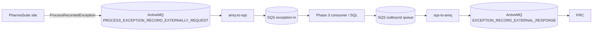

# ActiveMQ ⇄ AWS SQS Bridge

*Spanish version: [README.es.md](README.es.md)*

Two independent containers that move PharmaSuite exception messages between ActiveMQ (native OpenWire) and AWS SQS:

| Container | Direction | Default source | Default target |
|---|---|---|---|
| `amq-to-sqs` | Ingestion (Phase 2 of `PlanActiveMQ_a_SQL.md`) | ActiveMQ `PROCESS_EXCEPTION_RECORD_EXTERNALLY_REQUEST` | SQS `exception-in` |
| `sqs-to-amq` | Push-back to PRC (Phase 5) | SQS outbound queue (name TBD) | ActiveMQ `EXCEPTION_RECORD_EXTERNAL_RESPONSE` |



`amq-to-sqs` runs once for all configured sites. It reads each site's ActiveMQ broker, inbound queue, and SQS destination from `ingestion.yaml`; messages are routed to the SQS queue in the same site entry and include a `site` message attribute. Use `--env DEV`, `--env QA`, or `--env PROD` to select the environment. The `sqs-to-amq` module remains a separate outbound bridge.

---

## Project layout

```
activemq-sqs-bridge/
├── pom.xml                      # Maven parent (Java 17, activemq-client 5.15.0, AWS SDK v2)
├── bridge-common/               # Shared library
├── amq-to-sqs/                  # Multi-site ActiveMQ -> SQS ingestion
│   └── Dockerfile
├── sqs-to-amq/                  # Container 2: SQS -> ActiveMQ
│   └── Dockerfile
├── ingestion.yaml               # Site mapping by environment
├── config/
│   └── sqs-to-amq.env.example
├── local/localstack-init/
│   └── create-queues.sh         # Creates local SQS queues + DLQs in LocalStack
└── docker-compose.yml           # Local test stack
```

`activemq-client` is pinned to **5.15.0** because that is the `ProviderVersion` the target broker reported in its OpenWire handshake.

---

## Modules

### `bridge-common` — shared library

All services use this module, so connection handling, configuration and retry behaviour are the same everywhere.

| Class | Responsibility |
|---|---|
| `EnvConfig` | Reads settings with type checks: `required`, `optional`, `intValue`, `longValue`, `boolValue`, `durationValue`. Settings come from environment variables and, optionally, a `KEY=VALUE` file passed with `--config <file>` or `BRIDGE_CONFIG_FILE`. Real environment variables override the file. Durations accept `500ms`, `30s`, `5m`, `10m`, `1h`, `1h30m`, `1d` or ISO-8601 (`PT10M`). A bare number other than `0` is rejected because its unit would be ambiguous. A missing or invalid value raises a `ConfigException`, and the app exits with code 2 before it connects to anything. `secret(KEY)` also supports `KEY_FILE`, so passwords can be mounted as Docker/Kubernetes secrets instead of plain env vars. |
| `ActiveMqPoller` | The shared ActiveMQ consume loop (`INDIVIDUAL_ACKNOWLEDGE` session, reconnect with backoff). With `ACTIVEMQ_POLL_INTERVAL=0` it consumes continuously; a positive duration drains the queue, disconnects, and sleeps. Each configured site gets its own poller. |
| `MessageMetadata` | The JMS metadata that travels with a message (site, queue, JMS ID, timestamp, content type) and becomes SQS message attributes. |
| `XmlInspector` | Inspects XML payloads and optionally performs XSD validation. |
| `ActiveMqSettings` | Builds the `ActiveMQConnectionFactory` from `ACTIVEMQ_*` variables. It automatically wraps the URL in `failover:(...)` so the client reconnects with exponential backoff, and the failover `timeout` makes a blocked send fail instead of hanging forever. For `ssl://` URLs it uses `ActiveMQSslConnectionFactory` with an optional truststore and keystore (for mutual TLS). It sets prefetch = 1, so at most one unacknowledged message is held in memory, and an unlimited redelivery policy, so the client never poison-acks a message to the broker's DLQ. It turns off advisory topics, which often need extra broker permissions. `describe()` returns a log-safe summary with no passwords. |
| `SqsSettings` | Builds the AWS SDK v2 `SqsClient` from `AWS_REGION`, `SQS_QUEUE_URL` and an optional `SQS_ENDPOINT_OVERRIDE` (for LocalStack or a VPC interface endpoint). Credentials come from the **AWS default credentials chain** (env vars, `AWS_PROFILE`, web identity, container/instance role), so the code never handles secrets. It treats the queue as FIFO when the URL ends in `.fifo`. `AWS_ACCESS_KEY_ID`/`AWS_SECRET_ACCESS_KEY`/`AWS_SESSION_TOKEN` or `AWS_PROFILE` set in a `--config` file are also honoured, because the SDK itself only sees real environment variables. |
| `Backoff` | Exponential backoff with jitter (`RETRY_INITIAL_DELAY_MS`, `RETRY_MAX_DELAY_MS`), used for every reconnect and retry loop. |
| `BridgeRunner` | Runs the bridge loop on the main thread and registers a shutdown hook. On SIGTERM/SIGINT (`docker stop`) it signals the loop to stop and waits up to `SHUTDOWN_GRACE_MS` for in-flight work to finish. |
| `simplelogger.properties` | Logs to stdout with timestamps and thread names. AWS SDK and HTTP client noise is lowered to `warn`. |

### `amq-to-sqs` — multi-site ingestion container

It starts one independent consumer for every site in the selected environment. Each consumer sends to that site's configured SQS queue, adds the `site` attribute, and acknowledges the ActiveMQ message only after SQS accepts it. A broker outage on one site does not stop the other site consumers.

| Class | Responsibility |
|---|---|
| `AmqToSqsApp` | Entry point. Reads `INGESTION_CONFIG` and the required `--env` argument, validates all site entries, resolves optional broker secrets, and starts the site workers. |
| `MultiSiteBridge` | Runs each site's consumer on an independent worker thread. |
| `AmqToSqsBridge` | Reads `TextMessage` and `BytesMessage` (as UTF-8), passes each message to the Python publisher, then acknowledges it after a successful response. Failed sends retry with backoff and remain unacknowledged; a permanent rejection can hold up that site's queue. Logs identify only site and message ID, never message content. |
| `PythonSqsPublisher` | Maintains a local worker process and sends it the per-site queue URL, region, body, and attributes over JSON lines. |
| `sqs_publisher.py` | Uses `boto3.client("sqs", region_name=...)` and `send_message(QueueUrl=...)`. The queue URL comes from the same site's `sqs.queue_url` YAML entry. |
| `XmlInspector` | Parses the payload with an XXE-hardened DOM parser: DOCTYPE disallowed, secure processing on, external access blocked. It extracts `PSUniqueExceptionID`. If `XSD_PATH` points to `RAExternalExceptionHandling.xsd`, it also validates the payload. Inspection **never blocks forwarding**: an invalid or non-XML payload is still sent, with `SchemaValid=false`, and the downstream consumer decides what to do with it. |

**SQS message attributes added:**

| Attribute | Value |
|---|---|
| `site` | Exact site name from the selected YAML entry |
| `SourceSite` | Site name (used for S2 tagging) |
| `SourceQueue` | ActiveMQ queue name |
| `JmsMessageId` | Original JMS message ID |
| `JmsTimestamp` | JMS timestamp (Number) |
| `ContentType` | JMS `ContentType` property, or `text/xml` if absent |
| `PSUniqueExceptionID` | Extracted from the XML, if present |
| `SchemaValid` | `true`/`false`; only set when `XSD_PATH` is configured |

### `sqs-to-amq` — push-back container

It long-polls an SQS queue and publishes each message to the ActiveMQ outbound queue.

| Class | Responsibility |
|---|---|
| `SqsToAmqApp` | Entry point. Builds the `ReceiveMessageRequest` (batch size, long-poll wait, optional visibility timeout, all message attributes) and the publisher, then starts the bridge. |
| `SqsToAmqBridge` | Main loop. Receives a batch, publishes each message to ActiveMQ and **deletes it from SQS only after the broker accepted it**. If the publish fails, it resets the ActiveMQ connection, backs off and stops processing the current batch. The remaining messages become visible again after the visibility timeout, and after the queue's `maxReceiveCount` they move to the SQS DLQ (redrive policy configured on the AWS side). If the delete fails after a successful publish, it logs a warning, because the message will be delivered again as a duplicate. String/Number SQS attributes become JMS string properties, with names sanitized to valid Java identifiers that never start with the reserved `JMS` prefix. `SqsMessageId` is added, and `ContentType` defaults to `text/xml`. |
| `ActiveMqPublisher` | Producer that connects lazily and reconnects when needed. Persistent sends (the default) are synchronous: `send()` returns only after the broker accepted the message. Supports an optional message TTL. |

### Delivery guarantees

Both directions are **at-least-once**: a message should not be lost, but it can arrive twice. The Phase 3.2 idempotency check is therefore still required downstream. FIFO queues reduce duplicates on the SQS side, but only within the 5-minute deduplication window.

### Known limitations

- During a broker outage, a connect or send can block until the failover `timeout` expires (30 s by default) before the bridge reacts or shuts down.
- `sqs-to-amq` does not validate the payload, because the PRC response schema is still undefined (Phase 5.2).

---

## Configuration reference

`amq-to-sqs` reads site connections from `ingestion.yaml` (or the file named by `INGESTION_CONFIG`) and requires `--env DEV|QA|PROD`. Broker passwords are stored in AWS Secrets Manager; set `credentials_secret` to the secret name. The secret string must be a JSON object with `username` and `password`. Runtime tuning and AWS credentials are supplied through environment variables. `sqs-to-amq` continues to use its env-style configuration file.

### `sqs-to-amq` environment variables

| Variable | Required | Default | Description |
|---|---|---|---|
| `ACTIVEMQ_URL` | yes | — | e.g. `tcp://aznaampstalos1i:61646` or `ssl://host:61647` |
| `ACTIVEMQ_QUEUE` | no | outbound queue | Queue to publish to |
| `ACTIVEMQ_USER` | no | anonymous | Broker user |
| `ACTIVEMQ_PASSWORD` / `ACTIVEMQ_PASSWORD_FILE` | no | — | Broker password |
| `ACTIVEMQ_USE_FAILOVER` | no | `true` | Wrap the URL in `failover:(...)` |
| `ACTIVEMQ_FAILOVER_OPTIONS` | no | `initialReconnectDelay=1000&maxReconnectDelay=30000&useExponentialBackOff=true&timeout=30000` | Failover transport options |
| `ACTIVEMQ_SSL_TRUSTSTORE` / `_PASSWORD` | for `ssl://` | — | Truststore path and password |
| `ACTIVEMQ_SSL_KEYSTORE` / `_PASSWORD` | mutual TLS only | — | Client keystore |
| `ACTIVEMQ_MAX_REDELIVERIES` | no | `-1` | Client redelivery policy (`-1` = unlimited) |
| `AWS_REGION` | yes | — | AWS region |
| `SQS_QUEUE_URL` | yes | — | Source queue |
| `SQS_ENDPOINT_OVERRIDE` | no | — | LocalStack or VPC interface endpoint |
| AWS credentials | yes | — | Default chain: `AWS_ACCESS_KEY_ID`/`AWS_SECRET_ACCESS_KEY`, `AWS_PROFILE`, role, … |
| `RETRY_INITIAL_DELAY_MS` / `RETRY_MAX_DELAY_MS` | no | `1000` / `60000` | Backoff bounds |
| `SHUTDOWN_GRACE_MS` | no | `15000` / `30000` | How long shutdown waits for in-flight work |
| `JAVA_OPTS` | no | `-XX:MaxRAMPercentage=75` | JVM options. The JVM ignores `HTTPS_PROXY`; to use a proxy, pass `-Dhttps.proxyHost=... -Dhttps.proxyPort=...` here. |

### `amq-to-sqs` environment variables

| Variable | Required | Default | Description |
|---|---|---|---|
| `INGESTION_CONFIG` | no | `./ingestion.yaml` | YAML configuration path |
| `--env` | yes | — | Environment key from the YAML file (`DEV`, `QA`, or `PROD`) |
| `AWS_REGION` in YAML | yes | — | Region used by SQS and Secrets Manager |
| `activemq.url`, `activemq.queue` | yes per site | — | Broker endpoint and inbound queue |
| `sqs.queue_url` | yes per site | — | Destination queue for messages from that broker |
| `activemq.credentials_secret` | no | `null` | AWS Secrets Manager secret name with JSON `username` and `password` |
| `SQS_ENDPOINT_OVERRIDE` | no | — | LocalStack or VPC endpoint override |
| `XSD_PATH` | no | — | Path to `RAExternalExceptionHandling.xsd` |
| `SQS_MAX_MESSAGE_BYTES` | no | `262144` | Maximum SQS message body size; rejected messages remain unacknowledged |
| `ACTIVEMQ_RECEIVE_TIMEOUT_MS` | no | `1000` | Receive poll interval (also bounds shutdown latency) |
| `ACTIVEMQ_POLL_INTERVAL` | no | `0` | `0` = consume continuously. A duration (e.g. `5m`, `10m`) = drain the queue, disconnect, sleep for that long |

### `sqs-to-amq` only

| Variable | Required | Default | Description |
|---|---|---|---|
| `SQS_MAX_MESSAGES` | no | `10` | Messages per receive (1–10) |
| `SQS_WAIT_TIME_SECONDS` | no | `20` | Long-poll wait time |
| `SQS_VISIBILITY_TIMEOUT_SECONDS` | no | queue default | Override the visibility timeout |
| `ACTIVEMQ_PERSISTENT` | no | `true` | Persistent (synchronous) delivery |
| `ACTIVEMQ_MESSAGE_TTL_MS` | no | `0` | JMS time-to-live (`0` = never expires) |

### Minimum IAM permissions

- `amq-to-sqs`: `sqs:SendMessage` on each configured inbound queue.
- If `credentials_secret` is set: `secretsmanager:GetSecretValue` on the referenced broker secret.
- `sqs-to-amq`: `sqs:ReceiveMessage` and `sqs:DeleteMessage` on the outbound queue.
- If the queues use SSE-KMS: `kms:GenerateDataKey` (sender) and `kms:Decrypt` (receiver) on that key.

---

## Build and run

```bash
# Build the JARs (Java 17 + Maven)
mvn -B package

# Build the images (the build context is this folder)
docker build -f amq-to-sqs/Dockerfile -t amq-to-sqs:1.0.0 .
docker build -f sqs-to-amq/Dockerfile -t sqs-to-amq:1.0.0 .

# Run one process for all sites in the selected environment
docker run -d --name amq-to-sqs \
  -e INGESTION_CONFIG=/etc/bridge/ingestion.yaml \
  -v "$PWD/ingestion.yaml:/etc/bridge/ingestion.yaml:ro" \
  amq-to-sqs:1.0.0 --env DEV
```

The container includes Java 17, Python 3, and boto3, and runs as a non-root user (UID 10001). For local execution outside Docker, install `amq-to-sqs/requirements.txt` and set `PYTHON_PUBLISHER_SCRIPT` if the default source-tree path does not apply.

---

## Testing

> **Warning:** `amq-to-sqs` **removes** messages from the inbound queue. On a shared broker (Justin's validation environment or the Rockwell instance), other people will no longer see those messages. Coordinate with them before you point it there.

### 1. Start the local stack

```bash
cd activemq-sqs-bridge
docker compose up --build -d
docker compose logs -f amq-to-sqs
# expected: a configured site starts consuming
```

The stack starts ActiveMQ 5.15.9 (OpenWire on `61616`, web console on `8161`, admin/admin), LocalStack SQS on `4566` with the queues `exception-in`, `exception-out` and their DLQs, and both bridges. `amq-to-sqs` uses `config/local-ingestion.yaml` with the local `DEV` site.

### 2. Publish a message to ActiveMQ

Pick one of these options:

- **Web console:** go to http://localhost:8161/admin, open **Send**, set the destination to `PROCESS_EXCEPTION_RECORD_EXTERNALLY_REQUEST`, paste the content of `ProcessRecordedException.xml` and click **Send**. On the Rockwell instance the page is `http://aznaampstalos1d.ra-int.com:8162/admin/send.jsp`.
- **ActiveMQ REST API:**
  ```bash
  curl -u admin:admin --data-urlencode "body@ProcessRecordedException.xml" \
    "http://localhost:8161/api/message/PROCESS_EXCEPTION_RECORD_EXTERNALLY_REQUEST?type=queue"
  ```
- **Real end-to-end test:** create an exception in PharmaSuite (`PlantOperations` on the Rockwell instance). `ActivateExternalExceptionHandling` must be enabled, and the exception's Risk Class must be at or above `MinimalRiskClassForExternalExceptionHandling`.

### 3. Check that it worked

- In the logs: `Forwarded message for site=LOCAL jmsId=... to SQS id=...`.
- In the ActiveMQ console: the queue shows *Pending* = 0 and *Dequeued* goes up by 1.
- In SQS:
  ```bash
  docker compose exec localstack awslocal sqs receive-message \
    --queue-url http://localhost:4566/000000000000/exception-in --message-attribute-names All
  ```

### 4. Test the reverse direction

```bash
docker compose exec localstack awslocal sqs send-message \
  --queue-url http://localhost:4566/000000000000/exception-out --message-body '<test/>'
```

Then, in the ActiveMQ console, open **Browse** on `EXCEPTION_RECORD_EXTERNAL_RESPONSE`. The message should be there.

### 5. Resilience checks (optional)

- `docker compose stop localstack`, publish a message, then `docker compose start localstack`. The message should reach SQS once LocalStack is back.
- `docker compose restart activemq`. Both bridges should reconnect on their own.
- Restart ActiveMQ while multiple site entries are configured. Other site workers should continue running while the affected broker reconnects.

---

## Missing information

None of these items are defined in `PlanActiveMQ_a_SQL.md`.

**AWS**
1. AWS region and account ID, and the exact `exception-in` queue URL. Also whether the queue is standard or FIFO.
2. Name of the Phase 5 outbound SQS queue. Each site has its own broker, so this needs **one outbound queue per site** (e.g. `exception-out-andover`) or a routing rule that decides which site each message goes to.
3. DLQs for `exception-in` and the outbound queue, and the number of receive attempts allowed before a message moves to the DLQ (redrive `maxReceiveCount`).
4. How the on-prem host authenticates to AWS: IAM Roles Anywhere (recommended), IAM user access keys, or a profile.
5. IAM policies (see *Minimum IAM permissions*), plus the KMS key if the queues are encrypted.
6. Network path from on-prem to AWS: internet egress through a proxy, Direct Connect/VPN, or a VPC interface endpoint.
7. Where the containers will run at each site (host and orchestrator).

**Pfizer / ActiveMQ**

8. The exact site names to use in YAML (Andover, Grange Castle DP, Sanford).
9. Production broker URL for each site (`ssl`/61647) and its TLS certificates (truststore, and a keystore if mutual TLS is required).
10. OpenWire port of the Rockwell instance. The `:8162` we have is only the web console.
11. The `RAExternalExceptionHandling.xsd` file. It is optional; set it with `XSD_PATH`.
12. The payload schema PRC expects in the response, and confirmation that `EXCEPTION_RECORD_EXTERNAL_RESPONSE` is the right queue (Phase 5.1–5.2).
13. Expected message volume per site. It decides whether one consumer per site is enough.
